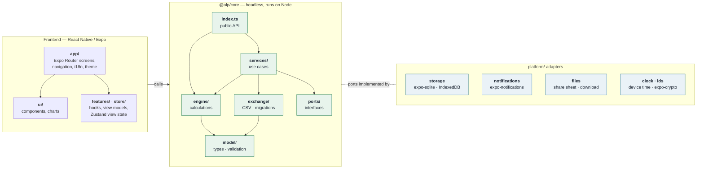

# Annuity Loan Planner: Design Document

| | |
|---|---|
| **Product** | Annuity Loan Planner |
| **Platforms** | iOS, Android, Web (single code base) |
| **Status** | Draft v0.3, 2026-11-01 (decisions: §9). Implemented: M1 core, M2 plan as installable PWA (§8) |
| **Languages** | German, English |
| **Repository** | `github.com/Treehopper/annuity` (the name sets the web path, §4.11) |
| **Web** | `https://www.hohenegger.eu/annuity/` (GitHub Pages, §4.11) |

---

## Getting started

```sh
npm install
npm run web            # Expo dev server (web); open the URL on an iPhone in the same network
npm test               # core (Node) + frontend (jest-expo) tests
npm run lint           # incl. the core boundary rules (§4.2)
npm run typecheck
npm run build:web      # static export + PWA post-processing into dist/ (§4.11)
node scripts/serve-dist.mjs   # serve dist/ at http://localhost:4173/annuity/ (BASE_PATH overrides the path)
npm run e2e            # Playwright on iPhone (WebKit) and desktop Chromium; needs build:web first
npm run icons          # re-render all icons from assets/icon/icon.svg
```

**iPhone:** open `https://www.hohenegger.eu/annuity/` in Safari, tap Share → "Add to Home Screen". The app then starts full-screen and works offline (service worker, §4.11). Data stays in that home-screen app's storage (IndexedDB).

---

## Contents

- [1. Goals and scope](#1-goals-and-scope)
  - [1.1 Problem](#11-problem)
  - [1.2 In scope (v1)](#12-in-scope-v1)
  - [1.3 Out of scope (v1)](#13-out-of-scope-v1)
- [2. Calculation reference](#2-calculation-reference)
  - [2.1 Reference calculator 1: term-based, with monthly special repayment](#21-reference-calculator-1-term-based-with-monthly-special-repayment)
  - [2.2 Reference calculator 2: initial repayment rate (bank standard)](#22-reference-calculator-2-initial-repayment-rate-bank-standard)
  - [2.3 Findings and required deviations](#23-findings-and-required-deviations)
- [3. Personas and user stories](#3-personas-and-user-stories)
  - [3.1 Persona](#31-persona)
  - [3.2 Epics and user stories](#32-epics-and-user-stories)
- [4. Technical design](#4-technical-design)
  - [4.1 Technology stack](#41-technology-stack)
  - [4.2 Architecture](#42-architecture)
  - [4.3 Repository layout](#43-repository-layout)
  - [4.4 Domain model](#44-domain-model)
  - [4.5 Persistence schema (SQLite)](#45-persistence-schema-sqlite)
  - [4.6 Automatic migration on device change (no backend)](#46-automatic-migration-on-device-change-no-backend)
  - [4.7 Core API and ports](#47-core-api-and-ports)
  - [4.8 Local notifications](#48-local-notifications)
  - [4.9 Extension point: sync (not in v1)](#49-extension-point-sync-not-in-v1)
  - [4.10 Privacy and security](#410-privacy-and-security)
  - [4.11 Identifiers, icon and deployment](#411-identifiers-icon-and-deployment)
  - [4.12 UI composition and adaptive layouts](#412-ui-composition-and-adaptive-layouts)
- [5. Calculation specification](#5-calculation-specification)
  - [5.1 Loan amount](#51-loan-amount)
  - [5.2 Monthly payment (annuity)](#52-monthly-payment-annuity)
  - [5.3 Schedule loop](#53-schedule-loop)
  - [5.4 Follow-up financing (after fixed-rate period)](#54-follow-up-financing-after-fixed-rate-period)
  - [5.5 Special repayment resolution for a period date `d`](#55-special-repayment-resolution-for-a-period-date-d)
  - [5.6 Validation rules](#56-validation-rules)
  - [5.7 Golden tests](#57-golden-tests)
  - [5.8 CSV schedule export](#58-csv-schedule-export)
  - [5.9 Backup CSV (export/import, platform switch)](#59-backup-csv-exportimport-platform-switch)
  - [5.10 Derived values and conventions](#510-derived-values-and-conventions)
  - [5.11 Loan lifecycle](#511-loan-lifecycle)
- [6. Screen design](#6-screen-design)
  - [6.1 Navigation map and routes](#61-navigation-map-and-routes)
  - [6.2 Overview](#62-overview)
  - [6.3 New / edit loan](#63-new--edit-loan)
  - [6.4 Financing helper (bottom sheet)](#64-financing-helper-bottom-sheet)
  - [6.5 Loan detail (dashboard)](#65-loan-detail-dashboard)
  - [6.6 Amortization schedule](#66-amortization-schedule)
  - [6.7 Special repayments & corrections](#67-special-repayments--corrections)
  - [6.8 Edit correction (bottom sheet)](#68-edit-correction-bottom-sheet)
  - [6.9 Scenarios](#69-scenarios)
  - [6.10 Compare loans](#610-compare-loans)
  - [6.11 Export dialog](#611-export-dialog)
  - [6.12 Notification examples](#612-notification-examples)
  - [6.13 Settings](#613-settings)
  - [6.14 Backup & import](#614-backup--import)
  - [6.15 Visual design](#615-visual-design)
  - [6.16 Theme chooser](#616-theme-chooser)
  - [6.17 Loan notifications (bottom sheet, native only)](#617-loan-notifications-bottom-sheet-native-only)
  - [6.18 Terminology](#618-terminology)
- [7. Quality, testing and release](#7-quality-testing-and-release)
  - [7.1 Test pyramid](#71-test-pyramid)
  - [7.2 Performance budgets](#72-performance-budgets)
  - [7.3 Device migration test procedure](#73-device-migration-test-procedure)
  - [7.4 Minimum platform versions](#74-minimum-platform-versions)
  - [7.5 Store and legal](#75-store-and-legal)
- [8. Milestones (suggested)](#8-milestones-suggested)
- [9. Decisions](#9-decisions)
  - [9.1 Former open questions](#91-former-open-questions)
  - [9.2 Decision log (v0.2, 2026-09-29)](#92-decision-log-v02-2026-09-29)

---

## 1. Goals and scope

### 1.1 Problem

A private borrower is planning a German-style annuity loan (*Annuitätendarlehen*) with a fixed-rate period (*Zinsbindung*) of typically 5 or 10 years, some equity, and regular special repayments (*Sondertilgungen*). They want to:

1. see the amortization schedule and, above all, the **remaining balance and totals at the end of the fixed-rate period** and the **projected payoff date**,
2. compare several loan offers and variants, with and without special repayments,
3. once the loan is running, record special repayments that deviated from the plan and immediately see the updated projection,
4. check each monthly bank statement quickly against the expected interest and principal split,
5. export the data as CSV and move it to a new device, including switching between iOS and Android.

### 1.2 In scope (v1)

- Loan offers and active loans, each with its own parameters (no combined financing).
- Three ways to define the monthly payment: initial repayment rate, term in years, or a fixed payment amount.
- Recurring special repayments (monthly or yearly) plus one-off entries.
- Corrections and confirmations of special repayments on running loans (as planned, changed amount, skipped, additional).
- Follow-up financing estimate after the fixed-rate period, using an assumed interest rate.
- Scenario comparison: with vs. without special repayments, original plan vs. current projection.
- Offer overview, sortable by several criteria.
- Local notifications: monthly payment breakdown, special repayment reminder, and fixed-rate end reminder.
- CSV export with a selectable format, plus CSV import (backup/restore and platform switch).
- Persistence that OS backup/restore migrates automatically (iCloud Backup, Android Auto Backup / device transfer).
- Light/dark mode and a theme chooser with several color palettes, including Solarized (§6.15).
- Web version as an offline-capable, installable PWA, primarily for iPhone home screens (Q9, DL-25).
- German/English, no tracking, no backend.

### 1.3 Out of scope (v1)

| Item | Note |
|---|---|
| Backend, accounts, cloud sync | Planned later as a premium feature or via Dropbox (see §4.9 extension point) |
| Combined financing (e.g. bank + KfW summed) | Loans are compared, not aggregated |
| Payout in tranches, commitment interest (*Bereitstellungszinsen*), grace periods | Explicitly excluded |
| Changing the repayment rate during the fixed-rate period | Explicitly excluded |
| Correcting anything other than special repayments (e.g. regular payment, balance reconciliation) | Explicitly excluded |
| Effective annual rate (*Effektivzins*, PAngV) including fees | Needs fee data; possible later |
| Validation against a contractual special-repayment cap (e.g. 5 % p.a.) | Excluded per requirements (Q6) |
| More than one follow-up period | The follow-up assumption runs until payoff |
| Biometric app lock | Excluded |
| Analytics, crash reporting SDKs, ads | Excluded (privacy) |

---

## 2. Calculation reference

The calculation rules were derived from an existing two-sheet spreadsheet loan calculator. The spreadsheet is **intentionally not part of the repository**. This section and the golden values in §5.7 capture everything needed from it; they are the single source of truth for the engine.

### 2.1 Reference calculator 1: term-based, with monthly special repayment

**Inputs**

| Input | Example |
|---|---|
| Loan amount | 280,000.00 € |
| Nominal interest rate p.a. | 3.08 % |
| Term in years (used to derive the annuity) | 18 |
| Payout date = first payment date | 2024-07-01 |
| Monthly special repayment (constant) | 1,100.00 € |

**Formulas**

With loan amount $P$, nominal rate $i$ p.a., term $N = 12 \cdot \text{years}$ months and constant special repayment $S$:

```math
A = P \cdot \frac{i/12}{1 - (1 + i/12)^{-N}} \approx 1{,}690.28\ \text{€} \quad \text{(not rounded)}
```

For each row $k = 1, 2, \dots$ with opening balance $B_1 = P$:

```math
\begin{aligned}
Z_k &= B_k \cdot \frac{i}{12} && \text{interest (not rounded)} \\
T_k &= A + S - Z_k && \text{principal (regular + special combined)} \\
B_{k+1} &= B_k - T_k && \text{closing balance = next opening balance} \\
d_{k+1} &= d_k + 1\ \text{month}, \quad d_1 = \text{payout date}
\end{aligned}
```

The table stops after the row whose closing balance is $\le 0$, or after $N$ rows. Totals: number of payments, $\sum S$, $\sum Z_k$.

Result: 117 payments instead of 216, total interest 44,176.22 €.

### 2.2 Reference calculator 2: initial repayment rate (bank standard)

**Inputs**

| Input | Example |
|---|---|
| Loan amount | 280,000.00 € |
| Nominal interest rate p.a. in % | 3.32 |
| Initial repayment rate p.a. in % (*anfängliche Tilgung*) | 8.60 |

**Formulas**

With initial repayment rate $t$:

```math
\begin{aligned}
A &= \mathrm{round}_{0.01}\!\left( P \cdot \frac{i + t}{12} \right) = 2{,}781.33\ \text{€} \\
Z_k &= B_k \cdot i \cdot \frac{30}{360} = B_k \cdot \frac{i}{12} && \text{(30/360 day count)} \\
T_k &= A - Z_k && \left(\text{row 1: } T_1 = P \cdot \tfrac{t}{12}\right) \\
B_{k+1} &= B_k - T_k
\end{aligned}
```

Totals: number of payments, total interest (sum of positive $Z_k$).

Result: 119 payments, total interest 48,640.43 €. There are no dates and no special repayments.

### 2.3 Findings and required deviations

| # | Finding in the reference calculators | Decision for the app |
|---|---|---|
| F1 | The final payment overshoots: the closing balance becomes negative (−2,287.03 € / −2,337.84 €), so the overpayment is counted as principal or special repayment | The last payment is capped at `balance + interest`. Special repayment in the last month is capped at what is still owed |
| F2 | Interest is not rounded; banks book to the cent | **Bank rounding mode** (default): interest per period rounded half-up to 0.01 €. **Spreadsheet mode** (tests and power users): no intermediate rounding |
| F3 | Calculator 1 does not round the annuity; calculator 2 does | Bank mode always rounds the annuity to 0.01 €. Spreadsheet mode reproduces each calculator's behavior (§5.2). Consequence: a term-derived annuity can need one extra tiny payment in bank mode (see golden test G3) |
| F4 | Calculator 1 sets the first payment on the payout date and charges a full month of interest | Separate `firstPaymentDate` input (default: 1st day of the month after payout). The first period is charged a full month of interest (30/360), see Q4 |
| F5 | There is no concept of a fixed-rate period or follow-up financing | Added: `fixedRateMonths` and a follow-up assumption (§5.4) |
| F6 | Special repayment is monthly and constant only | Generalized: recurring monthly/yearly rules plus per-occurrence overrides (actuals) |
| F7 | Payment defined by term (calculator 1) or initial repayment rate (calculator 2) | Both supported, plus "fixed payment amount" for entering an existing contract |
| F8 | The loan amount is entered directly; equity is not modelled | Loan amount is entered directly by default. An optional helper computes it from purchase price + incidental costs − equity (§5.1) |
| F9 | No validation (e.g. payment ≤ interest → endless loan, capped only by the row limit) | Validation rules (§5.6) |

---

## 3. Personas and user stories

### 3.1 Persona

**Anna, 38, is buying a condominium.** She has three offers from different banks, each with 10-year fixed rates and different interest and repayment rates. She wants to put in 60,000 € of equity and pay 1,100 € per month in special repayments from her salary. After signing, she checks her bank statement every month and occasionally pays a different special repayment than planned.

### 3.2 Epics and user stories

Priority: **M** = must (v1), **S** = should (v1 if time permits), **C** = could (later).

#### Epic A: Plan a loan

| ID | Story | Prio | Acceptance criteria |
|---|---|---|---|
| A1 | As a borrower, I want to enter loan amount, interest rate, fixed-rate period and payment definition, so that I get an amortization schedule. | M | Schedule is shown within ≤ 200 ms after the last input. All fields are validated inline (§5.6). The annuity is displayed immediately |
| A2 | As a borrower, I want to choose whether the payment is derived from the initial repayment rate, a total term or a fixed amount, so that I can enter any offer format. | M | Switching mode keeps the loan amount and rate. The derived values of the other modes are shown as read-only hints (e.g. "≙ 8.60 % initial repayment") |
| A3 | As a borrower, I want to optionally derive the loan amount from purchase price, incidental costs and equity. | S | Helper sheet computes the loan amount. The user can override it. Inputs are stored with the loan |
| A4 | As a borrower, I want to add a recurring special repayment (monthly or yearly, with start/end), so that I see its effect. | M | Yearly: choose the month (default January, and new rules are yearly). Start defaults to the first payment date. End defaults to the end of the fixed-rate period and follows it until set; it can be cleared to leave the rule open |
| A5 | As a borrower, I want to see the key figures at the end of the fixed-rate period. | M | The detail screen shows: remaining balance, interest paid, regular principal paid, special repayments paid, payments made, and the date (§5.10) |
| A6 | As a borrower, I want an estimate of the payoff date after the fixed-rate period, assuming a follow-up interest rate. | M | Default follow-up rate = current rate. Choose "keep monthly payment" or "recalculate with repayment rate x %". The estimate is visually marked as such |
| A7 | As a borrower, I want to duplicate a loan to create a variant. | M | Copy rules in §5.11. The name gets the suffix "(copy)" |
| A8 | As a borrower with only one loan, I want to see its details right away, without going through the overview. | M | With exactly one loan, the app opens on its detail screen. "New loan…" is in the detail's ⋮ menu (§6.2) |

#### Epic B: Compare

| ID | Story | Prio | Acceptance criteria |
|---|---|---|---|
| B1 | As a borrower, I want an overview of all loans/offers sortable by criteria, so that I find the best option. | M | Sort by: lowest interest rate, earliest payoff, lowest total interest, lowest remaining balance at fixed-rate end, lowest monthly payment, lowest monthly total outlay (§5.10). Ascending/descending toggle. Ties are ordered by name. The chosen sort and filter are remembered |
| B2 | As a borrower, I want to see what changes with vs. without special repayments. | M | The scenario screen shows both projections side by side, with deltas for payoff date, total interest and balance at fixed-rate end. For active loans, "without" means "no further special repayments from today" (§4.7) |
| B3 | As a borrower, I want to compare 2–3 selected loans side by side. | M | Table with the same rows for each loan. The best value per row is highlighted. Closed loans cannot be selected |
| B4 | As a borrower, I want a balance-over-time chart for the compared loans/scenarios. | S | Line chart per §6.15. Vertical marker at the fixed-rate end. Works in all themes |

#### Epic C: Run a loan

| ID | Story | Prio | Acceptance criteria |
|---|---|---|---|
| C1 | As a borrower, I want to mark an offer as "active" (contract signed), so that the original plan is frozen as a baseline. | M | Activating creates a baseline snapshot of params, rules and follow-up assumption. A status badge is shown. Only one baseline is kept; re-baselining needs an explicit confirmation (§5.11) |
| C2 | As a borrower, I want to correct a special repayment (different amount, skipped, additional one-off), so that the projection is updated. | M | Corrections are stored per date. The schedule, key figures and notifications are recomputed immediately. Corrected rows are marked in the schedule |
| C3 | As a borrower, I want to see the original plan vs. the current projection. | M | Deltas for payoff date, balance at fixed-rate end and total interest |
| C4 | As a borrower, I want to see the current month's payment split (interest / principal / special / balance after), so that I can check my bank statement. | M | The "This month" card is on the loan detail screen (§5.10). One tap copies the values |
| C5 | As a borrower, I want a monthly notification on the payment date with that split. | M | Opt-in per loan (§4.8). Content is shown in §6.12. Tapping it opens the month in the schedule. Not available on web |
| C6 | As a borrower, I want a reminder before a planned special repayment. | S | Configurable lead time (default 3 days). Tapping it opens the correction sheet for that date |
| C7 | As a borrower, I want a reminder before the fixed-rate period ends. | M | Default lead times: 12 months and 6 months before. Rationale: the forward-loan / follow-up negotiation window |
| C8 | As a borrower, I want to confirm that a planned special repayment was booked as planned. | M | One tap in the row detail or the correction sheet ("As planned"). "Confirm all past as planned" in §6.7. Past unconfirmed special repayments are counted as paid and marked (Q5) |
| C9 | As a borrower, I want to mark a paid-off loan as closed. | S | Suggested by a banner once the payoff date has passed (§5.11) |

#### Epic D: Data

| ID | Story | Prio | Acceptance criteria |
|---|---|---|---|
| D1 | As a borrower, I want to export a schedule as CSV in a format of my choice. | M | Options in §5.8. Monthly or yearly rows. Shared via the OS share sheet (web: download) |
| D2 | As a borrower, I want to export all my data as one backup CSV and import it on another device, including iOS ↔ Android and web. | M | Round-trip is lossless (golden test G7). The import shows a preview and a conflict strategy (§5.9) |
| D3 | As a borrower, I want my data to migrate automatically when I switch to a new phone of the same OS. | M | Data lives in the backed-up app data area (§4.6). Verified via the test procedure in §7.3 |
| D4 | As a user, I want the app in German or English, following the system language with a manual override. | M | All strings, number and date formats are localized. Any system language other than German (incl. regional variants such as `de-AT`, `de-CH`) falls back to English, and so do individual strings missing from `de.json`. Currency is always EUR |
| D5 | As a user, I want dark mode following the system with a manual override. | M | All screens and charts meet WCAG AA contrast in every theme and mode (§6.15) |
| D6 | As a user, I want to choose a color theme (e.g. Solarized). | M | Theme chooser (§6.16) with live preview. Each theme has a light and a dark variant. Choice is persisted and included in backups |

---

## 4. Technical design

### 4.1 Technology stack

| Concern | Choice | Rationale |
|---|---|---|
| Framework | **Expo (React Native), managed workflow, current SDK, New Architecture** | One code base for iOS, Android and web (react-native-web). Config plugins instead of native code |
| Language | TypeScript (strict) | |
| Navigation | Expo Router (file-based) | Same routes on native and web, deep links from notifications (§6.1) |
| State | Zustand (view state over the core services, §4.2) | Small, no boilerplate. Derived schedules are memoized selectors |
| Code structure | npm workspaces: Expo app at the root, headless `@alp/core` in `packages/core` (§4.2) | Business logic can later move to a Node backend without untangling frontend dependencies |
| Decimal math | `decimal.js-light` | Exact cent arithmetic without float drift. Pure JS, works everywhere |
| Dates | Own `YearMonth`/ISO date helpers on top of `date-fns` | Month arithmetic without timezone issues (store `YYYY-MM-DD` strings, never `Date` objects) |
| Persistence (native) | `expo-sqlite` | Stored in the app's backed-up data directory |
| Persistence (web) | IndexedDB via `idb` | Avoids expo-sqlite web (needs COOP/COEP headers + WASM, which GitHub Pages cannot set) |
| Notifications | `expo-notifications` (local only, no push token) | |
| File export/import | `expo-file-system`, `expo-sharing`, `expo-document-picker`; web: Blob download / `<input type=file>` | |
| CSV | `papaparse` | Robust quoting, delimiter detection, works on all platforms |
| i18n | `i18next` + `react-i18next` + `expo-localization`; `Intl.NumberFormat` / `Intl.DateTimeFormat` | Hermes ships Intl. `fallbackLng: 'en'`. Number and date formats use the resolved app language (`de-DE` or `en`), so a fallback to English also switches to English formatting |
| Charts | Small in-house line chart on `react-native-svg` | Works on web without Skia/WebGL, fewer dependencies |
| Theming | `useColorScheme` + palette registry of design tokens (§6.15) | Light/dark per palette, theme chooser |
| Typography | Platform system fonts (SF Pro, Roboto, `system-ui` on web) | No font download, works offline, respects Dynamic Type |
| Icons | `@expo/vector-icons` (Ionicons) | Bundled with the app, no network |
| Testing | Jest (core in a plain Node environment; frontend with `jest-expo`), React Native Testing Library, Maestro (E2E native), Playwright (web) | |
| Build/release | EAS Build + EAS Submit. Web: static export (`expo export -p web`) deployed to GitHub Pages via GitHub Actions (§4.11) | |

**Compatibility rule (per requirements):** Only APIs available on all three targets are used in shared code. Platform differences are isolated behind adapters (`*.native.ts` / `*.web.ts`). There are only three: storage, file I/O, notifications (web: feature hidden). No features that depend on OS-specific UI (widgets, Live Activities, Material You dynamic color) in v1.

### 4.2 Architecture

The code is split into a **headless core** and a **frontend**. The core holds the data model and all business logic and has no dependency on React, React Native, Expo or the browser. It could later run unchanged in a Node backend. For v1 the separation exists only in the TypeScript code: everything still runs in the app process, without network or process boundaries.



| Layer | Location | Contains | May depend on |
|---|---|---|---|
| **Core** (`@alp/core`) | `packages/core/` | Domain model and validation, calculation engine, use-case services, CSV/backup formats, document migrations, notification planning, port interfaces | Only the allowlisted pure-JS libraries (below) |
| **Frontend** | repository root (`app/`, `src/`) | Screens, components, hooks, Zustand view state, i18n, theme | `@alp/core` public API, React Native, Expo, UI libraries |
| **Platform adapters** | `src/platform/` | Implementations of the core's ports with `*.native.ts` / `*.web.ts` variants | `@alp/core` (types only), Expo modules, browser APIs |

- **Ports and adapters.** Everything the core needs from the outside world is an interface in `packages/core/src/ports/` (§4.7): storage, clock, ID generation, notification scheduling and file transfer. The frontend implements them in `src/platform/`. `src/composition.ts` is the only place that creates the adapters and passes them to `createCore(ports)`. A future Node backend would provide its own adapters (e.g. a database repository) and reuse the core unchanged.
- **Frontend only calls the core.** Hooks and the store call `@alp/core`'s public API (`index.ts`). Deep imports into the package are not allowed. The Zustand store is a view cache: it holds the loaded loans and settings for rendering, forwards every change to a core service, and stores the result. Derived schedules are memoized selectors over the core's projection functions.
- **No user-facing text in the core.** Validation results are message keys (§5.6), and planned notifications carry a message key and parameters (§4.8). The frontend translates them. The CSV column headers in §5.8 are part of the file format and therefore live in the core.
- **No ambient state in the core.** The core never reads the system clock, the time zone, random numbers or globals directly. These come in through ports, so behavior is reproducible in tests and on a server.
- Schedules are **never persisted**. They are always derived from inputs. This keeps storage tiny, avoids inconsistency, and makes backups small.
- Recalculation is synchronous: max 600 rows × a few scenarios is well under 10 ms on mid-range devices.

**How the boundary is enforced**

1. **Separate workspace package.** `packages/core` is an npm workspace with its own `package.json`. Its runtime dependencies are an allowlist: `decimal.js-light`, `date-fns`, `papaparse`. Each one is pure JavaScript and runs on Node LTS, in browsers and on Hermes. Adding a dependency requires the same check and an update of this list.
2. **No platform types.** `packages/core/tsconfig.json` sets `"lib": ["ES2022"]` and `"types": []`. DOM globals (`window`, `localStorage`, `navigator`), React Native globals and Node globals (`process`, `Buffer`) do not compile. That also covers APIs that differ between runtimes, such as `crypto.randomUUID` (hence the `IdGenerator` port).
3. **Lint rules.** In `packages/core`, `no-restricted-imports` forbids `react*`, `react-native*`, `expo*`, `@expo/*`, `@react-native*`, `zustand`, `i18next*`, `idb` and `node:*`. `import/no-extraneous-dependencies` enforces the allowlist, and `import/no-relative-packages` blocks relative imports out of the package. In the frontend, `no-restricted-imports` forbids deep imports such as `@alp/core/src/*`.
4. **Headless test run.** The core's Jest configuration uses `testEnvironment: 'node'` and does **not** use the `jest-expo` preset. Besides the unit and golden tests, an end-to-end service test runs a full flow against in-memory port adapters: create, activate, correct, export a backup, import it into an empty store. The in-memory adapters (`packages/core/test/inMemoryPorts.ts`) double as reference implementations for a future backend.
5. **CI.** `npm run lint`, `npm run typecheck` and `npm test` run in the deploy workflow on every push to `develop`. A failure in any of the steps above blocks the web deployment (§4.11).

**Build setup.** The Expo app stays at the repository root. The root `package.json` declares `"workspaces": ["packages/*"]`, and Expo's Metro configuration picks up npm workspaces automatically. `@alp/core` points `main`/`exports` to `src/index.ts`, so Metro and Jest compile it from source without a build step. A future Node backend would compile it with `tsc` or run it with `tsx`.

### 4.3 Repository layout

```
/package.json              Expo app; "workspaces": ["packages/*"]
/app                       Expo Router routes (see §6.1 route map)
/assets/icon/              icon.svg (source) + generated PNGs (§4.11)
/src/composition.ts        creates platform adapters, calls createCore(ports)
/src/panels/               content panels, layout-independent (§4.12)
/src/features/             hooks and view models (call @alp/core only)
/src/store/                Zustand view state
/src/platform/             port adapters: storage, clock, ids, notifications, files (native/web)
/src/ui/                   design system components
/src/ui/layout/            Pane, AdaptiveSheet, useLayoutClass, usePaneWidth, usePanelChrome (§4.12)
/src/ui/theme/             palettes.ts (§6.15), tokens.ts, useTheme.ts
/src/i18n/                 de.json, en.json
/packages/core/            @alp/core — headless, no frontend dependencies
  package.json             dependency allowlist (§4.2)
  tsconfig.json            lib ES2022, types []
  src/index.ts             public API: createCore, types, pure functions
  src/model/               domain types (§4.4), value formats
  src/validation/          rules (§5.6)
  src/engine/              annuity, schedule, followup, specials, kpis, compare, yearly
  src/services/            use cases: loans, lifecycle, settings, backup, import, notifications
  src/exchange/            CSV dialects, schedule export (§5.8), backup format and import (§5.9)
  src/migrations/          document migrations vN -> vN+1 (§4.5)
  src/ports/               interfaces implemented by adapters (§4.7)
  test/golden/             reference cases G1–G10 (§5.7)
  test/inMemoryPorts.ts    in-memory adapters for headless tests
/.github/workflows/        deploy-web.yml (§4.11)
/public/                   index.html template, manifest.webmanifest, web icons (PWA, §4.11)
/scripts/                  postexport-web.mjs (404, service worker), serve-dist.mjs, render-icons.mjs
/e2e/                      Playwright web E2E (§7.1)
```

### 4.4 Domain model

**Canonical value formats** (used in storage and backups, independent of UI locale):

- `Money`: decimal string with exactly two fraction digits, `.` as separator, no thousands separator (e.g. `'280000.00'`).
- `Rate`: decimal fraction with at most 6 fraction digits (i.e. percent with up to 4 decimals), trailing zeros trimmed (e.g. `'0.0308'`). The UI accepts up to 3 decimals in percent, which covers all common offers.
- `ISODate`: `YYYY-MM-DD`. Timestamps: ISO 8601 UTC (`2026-09-28T09:50:00Z`).

```ts
type ISODate = string;          // 'YYYY-MM-DD'
type Money = string;            // canonical, e.g. '280000.00'
type Rate = string;             // canonical fraction, e.g. '0.0308'

type LoanStatus = 'offer' | 'active' | 'closed';

interface Loan {
  id: string;                   // UUID v4
  name: string;                 // e.g. "DummyBank 10y 3.08 %"
  lender?: string;
  status: LoanStatus;
  params: LoanParams;
  specialRules: SpecialRepaymentRule[];
  specialOverrides: SpecialRepaymentOverride[];   // one-offs, corrections, confirmations
  followUp: FollowUpAssumption;
  baseline?: LoanBaseline;                         // frozen at activation
  notifications: LoanNotificationPrefs;
  notes?: string;
  createdAt: string; updatedAt: string;           // ISO timestamps (UTC)
}

interface LoanBaseline {
  params: LoanParams;
  specialRules: SpecialRepaymentRule[];
  followUp: FollowUpAssumption;
  createdAt: string;                               // ISO timestamp
}

interface LoanParams {
  principal: Money;
  financingHelper?: { purchasePrice: Money; incidentalCosts: Money; equity: Money };
  nominalRate: Rate;            // p.a.
  payoutDate: ISODate;          // required; offers: planned date, prefilled (§5.11)
  firstPaymentDate: ISODate;    // default: 1st of month after payout
  fixedRateMonths: number;      // 60, 120, 180 or custom
  payment:
    | { mode: 'initialRepayment'; initialRepaymentRate: Rate }   // calculator 2
    | { mode: 'term'; termMonths: number }                       // calculator 1
    | { mode: 'fixedAmount'; amount: Money };                    // from contract
  rounding: 'bank' | 'spreadsheet';                              // default 'bank'
}

interface SpecialRepaymentRule {
  id: string;
  frequency: 'monthly' | 'yearly';
  month?: number;               // 1..12, required for yearly
  amount: Money;
  start: ISODate;               // first period on/after this date
  end?: ISODate;                // inclusive, open if undefined
}

interface SpecialRepaymentOverride {
  id: string;
  date: ISODate;                // payment period the override applies to
  kind: 'asPlanned' | 'changed' | 'skipped' | 'additional';
  amount?: Money;               // required for changed/additional, absent otherwise
  confirmed: boolean;           // true = actually booked (actual), false = planned change
  note?: string;
}

interface FollowUpAssumption {
  rate: Rate;                   // default: nominalRate
  payment: { mode: 'keepPayment' }
         | { mode: 'repaymentRate'; rate: Rate };
  keepSpecialRules: boolean;    // default true
}

interface LoanNotificationPrefs {
  monthlyBreakdown: boolean;            // default false (opt-in, C5)
  specialReminderDaysBefore?: number;   // undefined = off; default 3
  fixedRateEndMonthsBefore: number[];   // default [12, 6]; [] = off
}

type PaletteId = 'classic' | 'solarized' | 'nord' | 'gruvbox' | 'catppuccin';

type SortKey = 'rate' | 'payoffDate' | 'totalInterest' | 'balanceAtFixedEnd'
             | 'payment' | 'monthlyOutlay';

interface CsvDialect {
  delimiter: ';' | ',' | '\t';
  decimal: ',' | '.';
  thousands: '' | '.' | ',';            // must differ from decimal and delimiter
  dateFormat: 'DD.MM.YYYY' | 'YYYY-MM-DD' | 'MM/DD/YYYY';
  encoding: 'utf8bom' | 'utf8';
  headerLanguage: 'de' | 'en';
}

interface CsvExportDefaults extends CsvDialect {
  preset: 'de' | 'en' | 'universal' | 'custom';
  granularity: 'monthly' | 'yearly';
  projection: 'current' | 'withoutSpecial' | 'originalPlan';
  includeParams: boolean;
}

interface Settings {
  language: 'system' | 'de' | 'en';    // 'system': German if the OS language is de-*, otherwise English
  appearance: 'system' | 'light' | 'dark';
  palette: PaletteId;                   // default 'classic'
  overviewSort: { key: SortKey; direction: 'asc' | 'desc' };
  overviewFilter: 'all' | 'offer' | 'active' | 'closed';
  csvDefaults: CsvExportDefaults;
  notifications: {                      // global master switches (§4.8)
    monthlyBreakdown: boolean;          // default true
    specialReminder: boolean;           // default true
    fixedRateEnd: boolean;              // default true
    newLoanDefaults: LoanNotificationPrefs;
  };
  lastBackupExportAt?: string;          // ISO timestamp, shown in §6.14
  disclaimerAcceptedAt?: string;        // ISO timestamp, first-start disclaimer (§7.5)
  schemaVersion: number;
}
```

**Derived types (not persisted)**

```ts
type SpecialStatus = 'none' | 'planned' | 'confirmed' | 'unconfirmed';

interface ScheduleRow {
  n: number; date: ISODate;
  opening: Money; payment: Money; interest: Money;
  regularPrincipal: Money; special: Money; closing: Money;
  phase: 'fixed' | 'followUp';
  isEstimate: boolean;          // = phase === 'followUp'
  specialSource: 'rule' | 'override' | 'none';
  specialStatus: SpecialStatus; // §5.5
  isActual: boolean;            // date <= today and loan is active/closed
}

interface LoanKpis {
  annuity: Money; initialRepaymentRate: Rate; monthlyOutlay: Money;
  atFixedRateEnd: { date: ISODate; balance: Money; interestPaid: Money;
                    regularPrincipalPaid: Money; specialPaid: Money; payments: number;
                    paidOffBeforeEnd: boolean };
  payoff: { date: ISODate; payments: number; totalInterest: Money;
            totalSpecial: Money; isEstimate: boolean };
  thisMonth?: { row: ScheduleRow; kind: 'current' | 'first' };   // §5.10
  unconfirmedSpecials: number;  // count of rows with specialStatus 'unconfirmed'
}

interface RankedLoan { loan: Loan; kpis: LoanKpis; rank: number }

interface YearRow {
  year: number;
  part: 'full' | 'fixed' | 'followUp';   // fixed-rate end year is split in two rows
  payments: number; interest: Money; regularPrincipal: Money;
  special: Money; closing: Money; isEstimate: boolean;
}
```

### 4.5 Persistence schema (SQLite)

Data is stored as **JSON documents per entity with a version column**. The data volume is tiny (< 100 loans), queries are trivial, and it lets the web IndexedDB adapter share the same shape and migrations.

```sql
CREATE TABLE meta     (key TEXT PRIMARY KEY, value TEXT NOT NULL);  -- schemaVersion
CREATE TABLE loans    (id TEXT PRIMARY KEY, json TEXT NOT NULL,
                       updated_at TEXT NOT NULL);
CREATE TABLE settings (id INTEGER PRIMARY KEY CHECK (id = 1), json TEXT NOT NULL);
```

- Writes are transactional and happen on every committed edit (debounced 300 ms for text inputs).
- `packages/core/src/migrations/` holds pure functions `vN -> vN+1` on the JSON documents. The same functions run for DB upgrades and for importing older backup CSVs.
- The pre-import backup (§6.14) is stored as one backup CSV string in `meta` under key `preImportBackup` (only the latest one is kept).

### 4.6 Automatic migration on device change (no backend)

| Platform | Mechanism | Design requirement |
|---|---|---|
| iOS | iCloud Backup / Quick Start device-to-device transfer | DB file in `Library/Application Support/` (expo-sqlite default location, backed up). Never in `Caches/` or `tmp/`. No `NSURLIsExcludedFromBackupKey` |
| Android | Auto Backup to Google Drive (≤ 25 MB) and device-to-device transfer | `android.allowBackup: true` (Expo default). Config plugin adds `dataExtractionRules` (Android 12+) and `fullBackupContent` (≤ 11) that **include** the `database` domain and exclude caches. DB size stays ≪ 25 MB |
| Web | None (browser-local only) | IndexedDB database `annuity-loan-planner`. Call `navigator.storage.persist()` on first save. Prompt for a backup CSV (D2) as the only transfer path. The origin `https://www.hohenegger.eu` is shared with other content on that domain (§4.11) |
| iOS ↔ Android | Not covered by OS | Backup CSV export/import (§5.9) |

Notification schedules are **not** restored by the OS. On app start the app always re-schedules from persisted preferences (§4.8).

### 4.7 Core API and ports

**Pure functions** (synchronous, no ports needed):

```ts
computeAnnuity(params): Money
buildSchedule(loan, opts?: { withoutSpecial?: boolean; useBaseline?: boolean;
                             today?: ISODate }): ScheduleRow[]
computeKpis(loan, schedule, today): LoanKpis
compareLoans(loans, sortKey, dir, today): RankedLoan[]
aggregateYearly(schedule, fixedRateMonths): YearRow[]
validateLoan(loan): ValidationIssue[]          // { path, messageKey, params }
```

**Services**, created once with the ports (asynchronous, because the ports are):

```ts
const core = createCore(ports);

core.loans:         list, get, create, update, delete, restore (undo),
                    duplicate, activate, rebaseline, revertToOffer, close, reopen   // §5.11
core.specials:      setOverride, removeOverride, confirmPastAsPlanned             // §5.5
core.settings:      get, update
core.exchange:      exportSchedule, exportBackup, previewImport, commitImport     // §5.8, §5.9
core.notifications: plan, sync                                                    // §4.8
```

Each mutating call validates its input, applies the business rule, writes through the ports, and returns the updated entity or a list of validation issues. It also stamps `updatedAt` from the `Clock` port.

**Ports** (`packages/core/src/ports/`):

```ts
interface DataStore {
  loans: LoanRepository;          // list, get, save, delete, listChanges(since)
  settings: SettingsRepository;   // get, save
  meta: MetaStore;                // get/set: schemaVersion, preImportBackup
  transaction<T>(fn: (store: DataStore) => Promise<T>): Promise<T>;
}
interface Clock { today(): ISODate; now(): string }   // today = the user's local calendar date
interface IdGenerator { uuid(): string }              // UUID v4
interface NotificationScheduler { replaceAll(plan: PlannedNotification[]): Promise<void> }
interface FileGateway {
  share(file: { name: string; mimeType: string; content: string; bom: boolean }): Promise<void>;
  pick(): Promise<{ name: string; content: string } | undefined>;
}

interface CorePorts { store: DataStore; clock: Clock; ids: IdGenerator;
                      notifications: NotificationScheduler; files: FileGateway }
```

| Port | Native adapter | Web adapter | Headless test / future backend |
|---|---|---|---|
| `DataStore` | expo-sqlite (§4.5) | IndexedDB via `idb` | in-memory; later e.g. a database |
| `Clock` | device clock and time zone | browser clock | fixed clock; later the client's date passed in the request |
| `IdGenerator` | `expo-crypto` | `crypto.randomUUID()` | deterministic sequence |
| `NotificationScheduler` | `expo-notifications`; translates each message key with i18next | no-op | records the plan |
| `FileGateway` | share sheet / document picker | Blob download / `<input type=file>` | in-memory files |

Every loan has three standard projections:

| Projection | Parameters used | Purpose |
|---|---|---|
| **Current** | params + rules + overrides + follow-up | Main view |
| **Without special repayments** | params + follow-up. Offers: all specials = 0. Active/closed loans: specials on dates ≤ today are kept as in *Current* (they count as paid, Q5); specials after today = 0 | B2 |
| **Original plan** | baseline params + baseline rules + baseline follow-up, no overrides | C3 (active/closed loans only) |

### 4.8 Local notifications

- **Eligibility:** only loans with status `active`. A notification type fires for a loan only if the global master switch in Settings is on **and** the loan's own preference is on. New loans get `Settings.notifications.newLoanDefaults` as their preferences.
- **Per-loan preferences** are edited in the loan's ⋮ menu → "Notifications…" (§6.17). The Settings screen holds the global switches and the defaults for new loans (§6.13).
- **Scheduling window:** iOS limits pending local notifications to 64 per app, so the app schedules a **rolling window**: the next 12 monthly breakdowns across all loans (nearest first), plus all special repayment reminders and fixed-rate-end reminders within 18 months. The window is capped at 60 total.
- **Timing:** all notifications fire at 08:00 local time. Monthly breakdown: on the payment date. Special reminder: `specialReminderDaysBefore` days before the payment date. Fixed-rate-end reminder: `addMonths(fixedRateEndDate, −m)` for each `m` in `fixedRateEndMonthsBefore` (§5.10). Exact timing is not required, so no exact-alarm permission is needed on Android.
- **Re-sync triggers:** app start, app foreground, any loan edit, override change, status change, settings change, language change (the content is localized at schedule time).
- **Planning vs. scheduling:** `core.notifications.plan()` decides which notifications exist, when they fire and the window cap above. It returns `PlannedNotification { id, loanId, kind, fireAt, messageKey, params, deepLink }`, where `fireAt` is a local date-time without a time zone. `sync()` hands the plan to the `NotificationScheduler` port. The native adapter translates the message and replaces the pending notifications.
- **Content** is precomputed from the current projection. Because it can be stale if the user never opens the app, the text says "expected" (see §6.12).
- **Permission:** requested only when the user first enables a notification toggle or activates a loan whose preferences have a notification enabled. On Android 13+ this is `POST_NOTIFICATIONS`. Web: the toggles are hidden and a hint is shown.
- **Deep links:** monthly breakdown → `annuity-loan-planner://loan/{id}/schedule?date=YYYY-MM-DD`; special reminder → `annuity-loan-planner://loan/{id}/special?date=YYYY-MM-DD` (opens §6.8); fixed-rate end → `annuity-loan-planner://loan/{id}`.

### 4.9 Extension point: sync (not in v1)

The `DataStore` port exposes `loans.listChanges(since)` and the services an `applyChanges(docs)` use case on the document level with `updated_at` last-writer-wins semantics. A later premium sync (Dropbox app folder, iCloud Drive document or similar) can export the same backup format (§5.9) to a user-owned cloud file. There is no server component in v1. If one is added later, it runs `@alp/core` on Node with server-side port adapters (§4.2), so client and server share the same model, validation, calculations and migrations.

### 4.10 Privacy and security

- No network calls at runtime (fonts and icons are bundled; the web build loads only its own static files).
- No analytics, crash reporting, advertising or third-party SDKs with telemetry. App Store privacy label: "Data Not Collected". Google Play Data Safety: no data collected or shared.
- Exported files contain financial data. The share sheet is used and no files are left in shared storage. Temporary export files are deleted after sharing.

### 4.11 Identifiers, icon and deployment

**Identifiers**

| Item | Value | Note |
|---|---|---|
| Display name | `Annuity Loan Planner` | Store listing and window title. The iOS/Android home-screen label may be truncated by the OS |
| Expo slug | `annuity-loan-planner` | |
| iOS bundle identifier | `eu.hohenegger.alp` | Same as Android; ALP = Annuity Loan Planner |
| Android `applicationId` / package | `eu.hohenegger.alp` | |
| URL scheme | `annuity-loan-planner` | Deep links (§4.8) |
| Web URL | `https://www.hohenegger.eu/annuity/` | GitHub Pages project site, path = repository name (`annuity`) |

**App icon:** the universal currency sign **¤** (U+00A4) as a placeholder until a final icon exists.

- Single source `assets/icon/icon.svg` with the glyph converted to an outlined path, so it does not depend on an installed font.
- Colors: glyph `#F5F7FA` on the Classic light `primary` `#1C6E8C` (§6.15).
- iOS: 1024 × 1024 px, no transparency. Android: adaptive icon with the glyph as foreground (inside the 66 % safe zone), solid background color, and a monochrome layer for Android 13 themed icons. Web: `favicon.svg` plus 32 px and 180 px PNGs. Splash screen: glyph on the theme `bg` color.

**Web deployment (GitHub Pages)**

- **Base path:** one source, `scripts/base-path.cjs`: the `BASE_PATH` environment variable, default `/annuity/`. `app.config.js` turns it into Expo's `experiments.baseUrl`, so all routes and asset URLs carry the prefix; `public/index.html` and `public/manifest.webmanifest` use the placeholder `__BASE__/`, which `scripts/postexport-web.mjs` replaces; the local server and Playwright use the same value. In CI, `actions/configure-pages` reports the base path GitHub serves the project site at, so the build always matches the repository name.
- `app.json`: `"web": { "output": "single" }` (single-page app).
- Workflow `.github/workflows/deploy-web.yml`, triggered by pushes to `develop` and manually (`workflow_dispatch`). Not by tags: the `github-pages` environment accepts deployments only from the default branch unless its protection rules allow more:
  1. checkout, `actions/setup-node` (LTS, npm cache), `npm ci`
  2. `actions/configure-pages` (reports `base_path`)
  3. `npm run lint`, `npm run typecheck` and `npm test` (boundary rules, core and golden tests must pass before deploying)
  4. `npm run build:web` with `BASE_PATH` from step 2: `expo export -p web`, then `scripts/postexport-web.mjs` (base path placeholders, service worker, step 5)
  5. `cp dist/index.html dist/404.html` (deep links such as `/annuity/loan/{id}` load the app instead of a GitHub 404 page) and `touch dist/.nojekyll`
  6. Playwright E2E on the exported build (Chromium, WebKit) under the same base path
  7. `actions/upload-pages-artifact` (path `dist`) and `actions/deploy-pages`; permissions `pages: write`, `id-token: write`; environment `github-pages`
- Repository setting: Pages source = "GitHub Actions".
- **Domain prerequisite:** `www.hohenegger.eu` is the custom domain of the account's user site (`Treehopper.github.io`); the apex `hohenegger.eu` is hosted at united domains, not on GitHub Pages. Project sites of that account are served under the custom domain automatically at `www.hohenegger.eu/<repository name>/` (e.g. `/CuppaScore/`), so this repository needs no `CNAME` file. For the path `/annuity/` the repository is named `annuity`; the build follows any name through `configure-pages`. HTTPS is enforced in the Pages settings.
- **Shared origin:** every page under `https://www.hohenegger.eu` shares the same browser origin. The app therefore only uses the IndexedDB database `annuity-loan-planner` and `localStorage` keys prefixed with `alp:`. The service worker (Q9) is scoped to `/annuity/` and only manages caches prefixed with `alp-`.

**PWA (Q9, DL-25)**

- `public/index.html` is the HTML template for the single-page export. It carries the iOS home-screen tags (`apple-mobile-web-app-capable`, status bar style, title "Loan Planner", `apple-touch-icon` 180 px), `viewport-fit=cover` for the safe areas, two `theme-color` tags (light/dark) that the app updates to the active palette's `bg` at runtime, and the link to `public/manifest.webmanifest` (`start_url` and `scope` = the base path, e.g. `/annuity/`, `display: standalone`, 192/512 px and maskable icons).
- `scripts/postexport-web.mjs` runs after `expo export`: it writes `404.html` and `.nojekyll` (step 4 above), checks the required head tags, injects the service worker registration and generates `dist/sw.js`. The worker precaches every exported file under a content-hashed cache name `alp-<hash>`; navigations are network-first with the cached `index.html` as offline fallback (deep links work offline), all other requests are cache-first. A new deploy produces a new hash, and the old caches are deleted on activation.
- iOS keeps the storage of a home-screen app separate from Safari's. Data entered in Safari does not appear in the installed app and vice versa; the backup CSV (§5.9) is the transfer path.


### 4.12 UI composition and adaptive layouts

The UI is built so that screen arrangements can change, e.g. list and detail side by side on tablets and desktop browsers, without rewriting the content. The content is built as **panels**. A thin **layout** layer, driven by the URL, decides whether panels are shown side by side or as separate screens.

**Layout classes.** `useLayoutClass()` derives the class from the **window** width (`useWindowDimensions`), not from the device type. That also covers iPad split view, foldables and resizable browser windows.

| Class | Window width | Loans section | Settings section |
|---|---|---|---|
| `compact` | < 600 px | Stack: overview → detail → sub-screens; bottom tab bar | Stack |
| `medium` | 600–839 px | Two panes: list (320 px) + detail; sub-screens replace the detail pane | List + selected sub-page |
| `expanded` | ≥ 840 px | Two panes: list (360 px) + detail; navigation rail instead of the tab bar | List + selected sub-page |

A three-pane arrangement (list + detail + schedule) is a possible later addition and needs only a layout change.

**Rules**

1. **Panels instead of screens.** Every content area is a panel component in `src/panels/`: `LoanListPanel`, `LoanDetailPanel`, `LoanEditPanel`, `SchedulePanel`, `SpecialRepaymentsPanel`, `ScenariosPanel`, `ComparePanel`, `ExportPanel`, `SettingsPanel`, `ThemePanel`, `BackupPanel`. A panel receives IDs and parameters as props and loads its data through `features/` hooks. It does not import the router and does not know the window size or its position on screen.
2. **Route files are thin.** Each file in `app/` reads its URL parameters and renders one panel. It contains no other logic.
3. **Panels report intents; they don't navigate.** Panels call callbacks such as `onSelectLoan(id)`, `onOpenSchedule(id, date)`, `onEditCorrection(id, date)` or `onCreateLoan()`. A `useLoanNavigation()` hook, provided by the section layout, maps each intent to a route change. In `compact` it pushes a screen; in two-pane classes it replaces the detail pane. This mapping is the only code that changes when the arrangement changes.
4. **The URL holds the selection.** `/loan/{id}` means "loan {id} is selected" in every layout class. Deep links (§4.8), browser back/forward and reloads behave the same everywhere. View options that must survive a layout switch (schedule granularity, projection, jump target) are URL parameters too.
5. **One layout file per section decides the arrangement.** `app/(loans)/_layout.tsx` renders a `Stack` in `compact`, or a row with `LoanListPanel` and a `Slot` for the detail routes otherwise. It also applies the single-loan rule (§6.2: list pane hidden, detail full width) and the empty state. `app/(settings)/_layout.tsx` works the same way.
6. **Panels adapt to their own width, not the window's.** A `<Pane>` wrapper (`src/ui/layout/`) measures itself with `onLayout` and provides the width through context. Panels read `usePaneWidth()` and choose their variant from it. For example, `SchedulePanel` uses two-line rows below 560 px and the single-line full table above, whether it fills a phone or a desktop detail pane.
7. **Panels declare their header, layouts render it.** A panel describes its title, status badge and actions as data (`usePanelChrome({ title, badge, actions })`). In `compact` the layout renders them as a stack header with back arrow and ⋮ menu; in two-pane classes as a pane toolbar. Actions such as "New loan…" (DL-22) are therefore defined once.
8. **Adaptive overlays.** Sheets use `<AdaptiveSheet>`: a bottom sheet in `compact`, a centered dialog in two-pane classes. This applies to the financing helper (§6.4), the correction editor (§6.8), loan notifications (§6.17) and the row detail of the schedule.
9. **No state that must survive in panel-local state.** Switching the layout class (e.g. by resizing a browser window or rotating a tablet) remounts panels. Selection and view options live in the URL (rule 4). Sort, filter and unsaved form drafts live in the Zustand store. Local state is only for transient UI such as an open dropdown.
10. **Panels are tested on their own.** Component tests render each panel at container widths of 360, 600 and 1,000 px. A development-only route `/dev/panels` shows all panels with sample data at these widths.

The mockups in §6 show the `compact` layout. In two-pane layouts the same panels appear next to the list; the ← back arrow is replaced by the selection in the list.

---

## 5. Calculation specification

All amounts are `Decimal`. Rounding is `ROUND_HALF_UP` to 0.01 € whenever `rounding = 'bank'`. With `rounding = 'spreadsheet'`, interest and balances are not rounded; only the annuity follows §5.2, and everything else is rounded for display only.

### 5.1 Loan amount

The principal $P$ is entered directly, or derived with the financing helper:

```math
P = \text{purchasePrice} + \text{incidentalCosts} - \text{equity}, \qquad P > 0
```

### 5.2 Monthly payment (annuity)

Notation: $P$ = `principal`, $i$ = `nominalRate`, $t$ = `initialRepaymentRate`, $N$ = `termMonths`, and the monthly rate $r = i/12$ (30/360 convention).

```math
A =
\begin{cases}
P \cdot \dfrac{i + t}{12} & \text{initialRepayment} \\[2ex]
P \cdot \dfrac{r}{1 - (1 + r)^{-N}} & \text{term},\ r > 0 \\[2ex]
\dfrac{P}{N} & \text{term},\ r = 0 \\[2ex]
\text{amount} & \text{fixedAmount}
\end{cases}
```

Rounding of `A` to 0.01 €:

| Mode | bank | spreadsheet |
|---|---|---|
| initialRepayment | rounded | rounded (as reference calculator 2) |
| term | rounded | **not rounded** (as reference calculator 1) |
| fixedAmount | as entered | as entered |

Derived hints shown to the user: the equivalent initial repayment rate

```math
t = \frac{12 \cdot A}{P} - i
```

and the resulting term from a dry run without special repayments.

### 5.3 Schedule loop

Notation: $R(x)$ rounds half-up to 0.01 € in bank mode and is the identity in spreadsheet mode. $N_\text{fix}$ = `fixedRateMonths`. $\hat S(d)$ is the special repayment resolved for date $d$ (§5.5, projection rules §4.7). $B_0 = P$ is the principal and $d_1$ = `firstPaymentDate`.

For $n = 1, 2, \dots$ while $B_{n-1} > 0$ and $n \le 600$ (hard cap: 50 years):

```math
\begin{aligned}
(i_n, A_n) &= \begin{cases} (i, A) & n \le N_\text{fix} \quad \text{fixed phase (§5.2)} \\ (i', A') & n > N_\text{fix} \quad \text{follow-up phase, estimate (§5.4)} \end{cases} \\[1ex]
Z_n &= R\!\left( B_{n-1} \cdot \frac{i_n}{12} \right) && \text{interest} \\[1ex]
T_n &= \min\left( A_n - Z_n,\ B_{n-1} \right) && \text{regular principal} \\[1ex]
S_n &= \begin{cases} 0 & A_n - Z_n \ge B_{n-1} \quad \text{(final payment, F1)} \\ \min\left( \hat S(d_n),\ B_{n-1} - T_n \right) & \text{otherwise} \end{cases} && \text{special repayment} \\[1ex]
\text{payment}_n &= T_n + Z_n \\[1ex]
B_n &= B_{n-1} - T_n - S_n && \text{closing balance} \\[1ex]
d_n &= \mathrm{addMonths}(d_1,\ n - 1)
\end{aligned}
```

Each iteration emits the row $(n, d_n, B_{n-1}, \text{payment}_n, Z_n, T_n, S_n, B_n, \text{phase}, \text{isEstimate} = n > N_\text{fix})$. The follow-up terms $(i', A')$ are computed once from $B_{N_\text{fix}}$, when $n = N_\text{fix} + 1$ is reached.

Notes:
- The special repayment is booked on the same date as the regular payment, after it (Q7). This is equivalent to reference calculator 1 ($T = A + S - Z$).
- `addMonths` keeps the original day-of-month of `firstPaymentDate` and clamps it to the month's length (Jan 31 → Feb 28/29 → Mar 31).
- If the loan is paid off within the fixed-rate period, the follow-up terms are never computed.
- Spreadsheet mode with `initialRepayment` reproduces reference calculator 2 in row 1: $T_1 = P \cdot t / 12$ instead of $A - Z_1$ (§2.2, golden test G4). From row 2 on, the loop above applies.

### 5.4 Follow-up financing (after fixed-rate period)

With $i'$ = `followUp.rate`, $t'$ = the follow-up repayment rate and $B_\text{fix} = B_{N_\text{fix}}$ the balance at the fixed-rate end:

```math
A' =
\begin{cases}
A & \text{keepPayment} \\[1ex]
\mathrm{round}_{0.01}\!\left( B_\text{fix} \cdot \dfrac{i' + t'}{12} \right) & \text{repaymentRate (rounded in both modes)}
\end{cases}
```

The follow-up payment must cover the interest. Otherwise validation fails with `err.followUp.belowInterest` ("follow-up payment does not cover interest"):

```math
A' > R\!\left( B_\text{fix} \cdot \frac{i'}{12} \right)
```

Special rules continue if `keepSpecialRules`; overrides always apply. All rows in the follow-up phase have `isEstimate = true`, and so does the payoff KPI if the last row is in the follow-up phase.

### 5.5 Special repayment resolution for a period date `d`

The planned amount is the sum over all rules that are active on $d$:

```math
\text{base}(d) = \sum_{\substack{\rho \in \text{rules} \\ \text{start}_\rho \,\le\, d \,\le\, \text{end}_\rho \\ \rho\ \text{monthly} \ \lor\ \text{month}(d) = \text{month}_\rho}} \text{amount}_\rho
```

An open end counts as $\text{end}_\rho = \infty$. With $o$ the override for date $d$ (at most one per date):

```math
\hat S(d) =
\begin{cases}
\text{base}(d) & \text{no override, or } o\ \text{is asPlanned} \\
0 & o\ \text{is skipped} \\
\text{amount}_o & o\ \text{is changed (replaces base)} \\
\text{base}(d) + \text{amount}_o & o\ \text{is additional}
\end{cases}
```

`specialStatus` of the row (evaluated for the resolved amount S before the final-payment cap):

| Condition | Status |
|---|---|
| S = 0 and no override | `none` |
| override exists and `confirmed = true` | `confirmed` |
| loan is `offer`, or d > today | `planned` |
| otherwise (active/closed loan, d ≤ today, not confirmed) | `unconfirmed` |

Unconfirmed past special repayments **count as paid as planned** (Q5). The detail screen shows a badge with the number of unconfirmed rows, linking to §6.7.

Overrides on dates that no longer exist in the schedule (e.g. after a parameter change) are kept and listed as "orphaned" in the special repayment screen. They are never deleted silently.

### 5.6 Validation rules

| Field | Rule | Message key |
|---|---|---|
| name | 1–80 characters after trimming | `err.name.required` / `err.name.length` |
| principal | 1,000 ≤ x ≤ 10,000,000 | `err.principal.range` |
| nominalRate | 0 % ≤ x ≤ 20 %, at most 3 decimals in percent | `err.rate.range` |
| initialRepaymentRate | 0.5 % ≤ x ≤ 30 % | `err.repayment.range` |
| termMonths | 12 ≤ x ≤ 600 | `err.term.range` |
| fixedAmount | > first-month interest | `err.payment.belowInterest` |
| fixedRateMonths | 12 ≤ x ≤ 480 | `err.fixed.range` |
| payoutDate | required | `err.payout.required` |
| firstPaymentDate | ≥ payoutDate and ≤ payoutDate + 12 months | `err.firstPayment.range` |
| helper fields | each ≥ 0 | `err.helper.negative` |
| helper | purchasePrice + costs − equity > 0 | `err.helper.equityTooHigh` |
| rule amount | > 0 | `err.special.amount` |
| rule start/end | end ≥ start (if set) | `err.special.endBeforeStart` |
| rule month | required for yearly, 1–12 | `err.special.month` |
| override amount | required and > 0 for `changed`/`additional`; absent for `asPlanned`/`skipped` | `err.override.amount` |
| override date | at most one override per date and loan | `err.override.duplicate` |
| override date not in schedule | warning, not an error (orphaned, §5.5) | `warn.override.orphaned` |
| followUp.rate | 0 % ≤ x ≤ 20 % | `err.followUp.rate` |
| followUp repayment rate | 0.5 % ≤ x ≤ 30 % | `err.followUp.repayment` |
| followUp payment | covers interest (§5.4) | `err.followUp.belowInterest` |
| notes / override note | ≤ 2,000 characters | `err.note.length` |
| specialReminderDaysBefore | 1–30 | `err.notify.days` |
| fixedRateEndMonthsBefore | 0–3 entries, each 1–36, distinct | `err.notify.months` |
| schedule | payoff within 600 months | `warn.schedule.tooLong` |

Validation is performed in `packages/core/src/validation/` and is shared by the UI, the services and the import.

### 5.7 Golden tests

These values are the reference for the engine. They were cross-checked against the reference calculators (spreadsheet mode) and recomputed independently from the rules in this section (bank mode). All loans start with the first payment on 2024-07-01.

| ID | Input | Mode | Expected |
|---|---|---|---|
| G1 | Calculator 1: 280,000 €, 3.08 %, term 216 months, special 1,100 €/month | spreadsheet | Annuity 1,690.28 € (unrounded 1,690.2841…). Row 1: interest 718.67 €, regular principal 971.62 €, special 1,100.00 € (calculator 1 shows the combined 2,071.62 €), closing 277,928.38 €. Row 116 closing 501.97 €. 117 payments. Total interest 44,176.22 € |
| G2 | as G1, fixed 60 months | bank | 117 payments, last payment 503.76 € (no special repayment in last month), total interest 44,176.24 €, total special 127,600.00 €, balance at fixed-rate end (2029-06) 145,807.24 €, interest paid by then 33,224.04 € |
| G3 | as G1 without special repayments, fixed 120 months | bank | 217 payments (rounded annuity leaves a residual), last payment 1.31 €, total interest 85,101.79 €, balance at fixed-rate end 143,659.68 €, interest paid 66,493.28 € |
| G4 | Calculator 2: 280,000 €, 3.32 %, initial repayment 8.60 % | spreadsheet | Annuity 2,781.33 €. Row 1: interest 774.67 €, principal 2,006.67 €. 119 payments. Total interest 48,640.43 € |
| G5 | as G4, fixed 60 months | bank | 119 payments, last payment 443.43 €, total interest 48,640.37 €, balance at fixed-rate end 149,226.56 €, interest paid 36,106.36 € |
| G6 | G2 with overrides: 2025-03-01 skipped, 2025-12-01 additional 5,000 € | bank | Row 2025-03 special = 0; row 2025-12 special = 6,100.00. 115 payments (payoff 2034-01), last payment 1,106.65 €, total interest 43,098.57 €, total special 129,300.00 €, balance at fixed-rate end 141,492.56 €, interest paid 32,809.36 € |
| G7 | Backup round-trip of G1–G6 and G8–G10 in all CSV dialects, including settings | – | Imported loans and settings deep-equal the exported ones |
| G8 | as G1, fixed 120 months, override 2026-11-01 changed 800 € (mockup example, §6) | bank | 117 payments (payoff 2034-03), row 2026-10: interest 570.21 €, principal 1,120.07 €, closing 219,939.51 €; last payment 879.71 € (interest 2.25 €, principal 877.46 €), total interest 44,252.19 € (+75.95 € vs. plan), total special 127,300.00 €, balance at fixed-rate end 0.00 € (paid off before end) |
| G9 | 280,000 €, 2.95 %, initial repayment 4.00 %, special 1,100 €/month, fixed 60 months, follow-up 4.00 % keep payment | bank | Annuity 1,621.67 €. Balance at fixed-rate end (2029-06) 148,716.55 €, 121 payments (payoff 2034-07, estimate), last payment 1,142.23 €, total interest 47,742.63 € |
| G10 | G8 as active loan, projection "without special repayments", today = 2026-10-15 | bank | Specials kept through row 28 (2026-10), 30,800.00 € in total. 187 payments (payoff 2040-01, estimate), last payment 933.15 €, total interest 66,125.23 €, balance at fixed-rate end (2034-06) 103,286.40 € |

Plus property-based tests (fast-check): the sum of principal + special equals the loan amount exactly, the balance never goes negative, and the balance is monotonically decreasing.

### 5.8 CSV schedule export

**Selectable dialect** (defaults follow the app language):

| Option | Values | Default DE | Default EN |
|---|---|---|---|
| Delimiter | `;` `,` `Tab` | `;` | `,` |
| Decimal separator | `,` `.` | `,` | `.` |
| Thousands separator | none, `.`, `,` | none | none |
| Date format | `DD.MM.YYYY`, `YYYY-MM-DD`, `MM/DD/YYYY` | `DD.MM.YYYY` | `YYYY-MM-DD` |
| Encoding | UTF-8 with BOM, UTF-8 | with BOM (for Excel) | UTF-8 |
| Header language | DE, EN | DE | EN |
| Granularity | monthly, yearly | monthly | monthly |
| Projection | current, without special, original plan | current | current |
| Include parameter block | yes/no | yes | yes |

Invalid combinations (decimal separator = delimiter, thousands separator = decimal separator or delimiter) are blocked in the UI. Quoting follows RFC 4180 (fields containing the delimiter, a quote or a line break are enclosed in `"`; quotes are doubled). Line endings are CRLF.

**Columns**

| Key | EN header | DE header | Monthly | Yearly |
|---|---|---|---|---|
| n | No | Nr | ✓ | |
| date | Date | Datum | ✓ | |
| year | Year | Jahr | | ✓ |
| phase | Phase | Phase | ✓ | ✓ |
| payments | Payments | Raten | | ✓ |
| opening | Opening balance | Restschuld Anfang | ✓ | |
| payment | Payment | Rate | ✓ | |
| interest | Interest | Zinsen | ✓ | ✓ |
| principal | Principal | Tilgung | ✓ | ✓ |
| special | Special repayment | Sondertilgung | ✓ | ✓ |
| closing | Closing balance | Restschuld Ende | ✓ | ✓ |
| actual | Actual | Ist | ✓ | |
| specialStatus | Special status | Status Sondertilgung | ✓ | |

Column order: monthly `No; Date; Opening balance; Payment; Interest; Principal; Special repayment; Closing balance; Phase; Actual; Special status`; yearly `Year; Phase; Payments; Interest; Principal; Special repayment; Closing balance`. Cell values: phase `fixed`/`follow-up (estimate)` (DE `Zinsbindung`/`Anschluss (Schätzung)`), yearly phase additionally `full` (DE `gesamt`); actual `yes`/`no` (DE `ja`/`nein`); special status `planned`/`confirmed`/`unconfirmed`/empty (DE `geplant`/`bestätigt`/`unbestätigt`).

**Parameter block** (optional): leading lines whose first cell is `# <key>`, followed by one or more value cells in the chosen delimiter, then one blank line, then the table. Keys are fixed English identifiers regardless of header language. Values use the chosen decimal separator and date format but **never** a thousands separator. Rates are given in percent.

```
# format;ANNUITY-LOAN-PLANNER-SCHEDULE;v1
# exported;2026-09-28T09:50:00Z
# dialect;delimiter=semicolon;decimal=comma;date=DD.MM.YYYY
# projection;current
# name;DummyBank 10y
# lender;DummyBank
# principal;280000,00
# nominalRatePercent;3,08
# payoutDate;15.06.2024
# firstPaymentDate;01.07.2024
# fixedRateMonths;120
# payment;term;216
# rounding;bank
# followUp;3,08;keepPayment;;true
# rule;monthly;;1100,00;01.07.2024;
# override;01.11.2026;changed;800,00;true;Holiday
```

| Key | Values |
|---|---|
| `format` | `ANNUITY-LOAN-PLANNER-SCHEDULE`; version (`v1`) |
| `exported` | ISO timestamp |
| `dialect` | `delimiter=semicolon\|comma\|tab`; `decimal=comma\|dot`; `date=<format>` |
| `projection` | `current`, `withoutSpecial` or `originalPlan` |
| `name`, `lender` | text (`lender` may be empty) |
| `principal` | amount |
| `nominalRatePercent` | percent |
| `payoutDate`, `firstPaymentDate` | date |
| `fixedRateMonths` | integer |
| `payment` | mode (`initialRepayment`, `term`, `fixedAmount`); value (percent, months or amount) |
| `rounding` | `bank` or `spreadsheet` |
| `followUp` | rate percent; `keepPayment` or `repaymentRate`; repayment rate percent (empty for keepPayment); keepSpecialRules `true`/`false` |
| `rule` (repeatable) | frequency; month (empty for monthly); amount; start; end (empty = open) |
| `override` (repeatable) | date; kind; amount (may be empty); confirmed `true`/`false`; note |

For the "original plan" projection, `name` through `rule` describe the baseline and no `override` lines are written.

### 5.9 Backup CSV (export/import, platform switch)

A single file with a **record-type column**, so that it stays one CSV file (per requirements) and is still readable in a spreadsheet.

**File structure**

1. **Line 1, signature:** space-separated so it can be read before the delimiter is known:
   `#ANNUITY-LOAN-PLANNER-BACKUP v1 exported=<ISO timestamp> delimiter=<semicolon|comma|tab> decimal=<comma|dot>`
2. **Line 2, header:** `record;id;loan_id;f1;f2;…;f12` (in the declared delimiter).
3. **Records**, one per line, in this order: `SETTING` rows, then per loan its `LOAN` row followed by its `PARAMS`, `FOLLOWUP`, `RULE`, `BASELINE`, `OVERRIDE` and `NOTIFY` rows.

**Encoding rules**

- UTF-8; a BOM is written only if the user chose "UTF-8 with BOM" and is accepted on import either way. CRLF line endings; LF is accepted on import.
- Quoting per RFC 4180 (see §5.8). Notes may contain line breaks.
- Empty field = value not set. Writers omit trailing empty fields; readers treat missing fields as empty.
- Money: canonical format (§4.4) with the declared decimal separator, never a thousands separator. Rates: canonical **fraction** (not percent) with the declared decimal separator. Dates and timestamps: always ISO. Booleans: `true`/`false`. Lists: `|`-separated (e.g. `12|6`).
- IDs are the full UUIDs of the entities.

**Record types** (`id` / `loan_id` columns, then the fields `f1…`)

| Record | id | loan_id | Fields f1… |
|---|---|---|---|
| `SETTING` | – | – | key (dotted path of a `Settings` leaf, e.g. `palette`, `overviewSort.key`, `csvDefaults.delimiter`, `notifications.newLoanDefaults.fixedRateEndMonthsBefore`); value. Delimiter values are written as `semicolon`/`comma`/`tab`. `schemaVersion` is not written (it is in the signature) |
| `LOAN` | loan id | – | name; lender; status; notes; createdAt; updatedAt |
| `PARAMS` | – | loan id | scope (`current`\|`baseline`); principal; nominalRate; payoutDate; firstPaymentDate; fixedRateMonths; paymentMode; paymentValue (rate, months or amount); rounding; helperPurchasePrice; helperIncidentalCosts; helperEquity |
| `FOLLOWUP` | – | loan id | scope; rate; paymentMode (`keepPayment`\|`repaymentRate`); repaymentRate; keepSpecialRules |
| `RULE` | rule id | loan id | scope; frequency; month; amount; start; end |
| `BASELINE` | – | loan id | createdAt (the baseline's `PARAMS`, `FOLLOWUP` and `RULE` rows use scope `baseline`) |
| `OVERRIDE` | override id | loan id | date; kind; amount; confirmed; note |
| `NOTIFY` | – | loan id | monthlyBreakdown; specialReminderDaysBefore; fixedRateEndMonthsBefore |

**Example** (IDs shortened)

```
#ANNUITY-LOAN-PLANNER-BACKUP v1 exported=2026-09-28T09:50:00Z delimiter=semicolon decimal=comma
record;id;loan_id;f1;f2;f3;f4;f5;f6;f7;f8;f9;f10;f11;f12
SETTING;;;language;system
SETTING;;;appearance;dark
SETTING;;;palette;solarized
SETTING;;;overviewSort.key;payoffDate
SETTING;;;overviewSort.direction;asc
LOAN;9f1c…;;DummyBank 10y;DummyBank;active;;2024-05-20T18:02:11Z;2026-09-28T09:40:12Z
PARAMS;;9f1c…;current;280000,00;0,0308;2024-06-15;2024-07-01;120;term;216;bank;320000,00;20000,00;60000,00
FOLLOWUP;;9f1c…;current;0,0308;keepPayment;;true
RULE;a71b…;9f1c…;current;monthly;;1100,00;2024-07-01
BASELINE;;9f1c…;2024-06-10T07:30:00Z
PARAMS;;9f1c…;baseline;280000,00;0,0308;2024-06-15;2024-07-01;120;term;216;bank;320000,00;20000,00;60000,00
FOLLOWUP;;9f1c…;baseline;0,0308;keepPayment;;true
RULE;a71b…;9f1c…;baseline;monthly;;1100,00;2024-07-01
OVERRIDE;c3d2…;9f1c…;2026-11-01;changed;800,00;true;Holiday
NOTIFY;;9f1c…;true;3;12|6
```

**Import**

- **Flow:** pick file → read signature (reject if missing) → parse → validate (shared rules §5.6; rows referencing an unknown `loan_id` are dropped with a warning; duplicate IDs are an error) → run migrations if `vN < current` → preview ("3 loans, 12 corrections; 1 conflict") → strategy → commit in one transaction.
- **Strategies:**
  - *Merge (keep newer)*, default: per loan ID, the whole loan document (incl. rules, overrides, baseline) with the newer `updatedAt` wins; loans that exist only on one side are kept. Device settings are kept.
  - *Replace all*: all loans **and** settings are replaced. Requires a second confirmation; a pre-import backup is written first (§4.5).
  - *Import as copies*: every imported loan gets new IDs (loan, rules, overrides) and the name suffix "(imported)". Device settings are kept.
- **Schedule CSVs** (§5.8) can also be imported, but only as a new loan (status `offer`) built from the parameter block. Rows are ignored because they are derived. If the `format` line is missing, the import is rejected with an explanation.
- Unknown record types, unknown `SETTING` keys and extra trailing fields are ignored with a warning (forward compatibility).

### 5.10 Derived values and conventions

| Value | Definition |
|---|---|
| **today** | The device's local calendar date. Recomputed on app start, on foreground and at local midnight while open |
| **Fixed-rate end date** | Date of payment $n = N_\text{fix}$, i.e. $\mathrm{addMonths}(d_1, N_\text{fix} - 1)$, shown as month/year. The key figures at the fixed-rate end are the state *after* that payment, which matches the "remaining balance at end of fixed-rate period" in bank offers |
| **atFixedRateEnd if paid off earlier** | `balance = 0.00`, `date` = fixed-rate end date, totals = lifetime totals, `payments` = total payments, `paidOffBeforeEnd = true` |
| **Payoff** | Date of the last row. `isEstimate` if that row is in the follow-up phase |
| **This month** | The row whose date is in today's calendar month (`kind: 'current'`). Before the first payment: the first row (`kind: 'first'`, card title "First payment"). After payoff: no card; the detail shows "Paid off MM/YYYY" instead. Shown for active loans only |
| **Monthly outlay** | $A + \sum_{\rho\ \text{monthly}} \text{amount}_\rho + \sum_{\rho\ \text{yearly}} \frac{\text{amount}_\rho}{12}$ over the rules active on the reference date, rounded to the cent. Reference date: this month's row date for active loans, `firstPaymentDate` otherwise. Overrides are ignored (they are one-offs). An average, so the UI labels it "Avg. monthly outlay" / "Ø Monatsbelastung" and shows the breakdown (payment, monthly specials, yearly specials with their month) |
| **Best value in Compare** | Lowest value per row; payoff by earliest date. Fixed period is not ranked. Ties get a ★ each |

### 5.11 Loan lifecycle

| Action | From → to | Effect |
|---|---|---|
| Create | – → offer | `payoutDate` prefilled with the 1st of next month, `firstPaymentDate` with the 1st of the month after that. Notification prefs from `Settings.notifications.newLoanDefaults` |
| Mark as active | offer → active | Snapshot of params, rules and follow-up into `baseline` (confirmation dialog). Notifications become eligible |
| Edit (active) | – | Name, lender, notes, special rules, overrides, follow-up assumption and notifications are editable. Contract data (`LoanParams`) is locked; "Edit contract data" unlocks it after a confirmation that saving will re-baseline |
| Re-baseline | active → active | Replaces the baseline with the current params, rules and follow-up. Overrides are kept unchanged. Confirmation required |
| Revert to offer | active → offer | Confirmation required. Baseline is discarded; overrides are kept |
| Mark as closed | active → closed | Suggested by a banner once the payoff date ≤ today. Read-only except name, lender, notes; can be deleted. No notifications. Excluded from Compare selection. Shown under the "Closed" filter and under "All" |
| Reopen | closed → active | Restores the active state including the baseline |
| Duplicate | any → offer | New loan ID, name + " (copy)". Copies lender, notes, params (incl. financing helper), rules and follow-up (new rule IDs), and overrides with new IDs and `confirmed = false`. Not copied: baseline, status, notification prefs (reset to new-loan defaults) |
| Delete | any → – | Undo snackbar (5 s), then permanent |

---

## 6. Screen design

### 6.1 Navigation map and routes

```
[Tab: Loans] ─── Overview (6.2)
                   ├── + New / Edit loan (6.3)
                   │      └── Financing helper (6.4)
                   ├── Loan detail (6.5)
                   │      ├── Schedule (6.6)
                   │      ├── Special repayments & corrections (6.7)
                   │      │      └── Edit correction (6.8)
                   │      ├── Scenarios: with/without, plan vs current (6.9)
                   │      ├── Export (6.11)
                   │      └── Loan notifications (6.17)
                   └── Compare (select 2–3) (6.10)
[Tab: Settings] ── Settings (6.13) ─┬─ Theme (6.16)
                                    └─ Backup / Import (6.14)
```

| Route | Screen |
|---|---|
| `/` | Overview; with exactly one loan, replaced by that loan's detail (§6.2) |
| `/loan/new`, `/loan/[id]/edit` | New / edit loan |
| `/loan/[id]` | Loan detail |
| `/loan/[id]/schedule?date=` | Schedule, scrolled to `date` |
| `/loan/[id]/special?date=` | Special repayments; with `date`, the correction sheet for that date is open |
| `/loan/[id]/scenarios` | Scenarios |
| `/loan/[id]/export` | Export dialog |
| `/loan/[id]/notifications` | Loan notifications |
| `/compare?ids=a,b,c` | Compare |
| `/settings`, `/settings/theme`, `/settings/backup` | Settings, theme chooser, backup & import |

On web, all routes are prefixed with `/annuity`. On native, the same paths are reachable via the `annuity-loan-planner://` scheme.

Phones use a bottom tab bar. From 600 px window width, the overview list and the detail are shown side by side, and from 840 px a navigation rail replaces the tab bar (§4.12). Route files live in the groups `app/(loans)/` and `app/(settings)/`, whose `_layout.tsx` files choose the arrangement.

All example figures in the mockups are computed with the engine rules of §5 (bank mode) for the reference example loan (280,000 €, 3.08 %, 1,690.28 € + 1,100 € special, first payment 07/2024, 10-year fixed rate) and one correction (11/2026: 800 € instead of 1,100 €), with today in 10/2026. They correspond to golden tests G8–G10.

### 6.2 Overview

```
┌──────────────────────────────────────┐
│ Loans                          [+]   │
├──────────────────────────────────────┤
│ Sort: Earliest payoff ▾      [↑↓]    │
│ Filter: (All) (Offers) (Active)      │
│         (Closed)                     │
├──────────────────────────────────────┤
│ ● ACTIVE                             │
│ DummyBank 10y                 3.08 % │
│ Payment 1,690.28 € + 1,100.00 €      │
│ Fixed-rate end 06/2034:   0.00 €  ✓  │
│ Paid off 03/2034           117 mo.   │
├──────────────────────────────────────┤
│ ○ OFFER                              │
│ Bank B 10y                    3.32 % │
│ Payment 2,781.33 €                   │
│ Fixed-rate end 06/2034:   0.00 €  ✓  │
│ Paid off 05/2034           119 mo.   │
├──────────────────────────────────────┤
│ ○ OFFER                              │
│ Bank C 5y                     2.95 % │
│ Payment 1,621.67 € + 1,100.00 €      │
│ Fixed-rate end 06/2029: 148,717 €    │
│ Paid off 07/2034 (est.)    121 mo.   │
├──────────────────────────────────────┤
│ [ Compare… ]                         │
├──────────────────────────────────────┤
│   Loans                  Settings    │
└──────────────────────────────────────┘
```

- The sort menu offers: Lowest interest rate · Earliest payoff · Lowest total interest · Lowest balance at fixed-rate end · Lowest payment · Lowest monthly outlay.
- The card line that matches the active sort key is emphasized (bold).
- Swipe actions: Duplicate, Delete (with undo snackbar). Long press: select for Compare (not for closed loans).
- Empty state: a large ¤ glyph in `primary`, "Plan your first loan" and a [Create loan] button.
- **Single loan:** if exactly one loan exists (any status), the overview is skipped and the app opens that loan's detail (§6.5) directly, as the root of the Loans tab. The route `/` redirects with *replace*, so there is no back arrow and no overview behind it. In two-pane layouts (§4.12) the list pane is hidden and the detail uses the full width. New loans are added via ⋮ → "New loan…" in the detail.
  - After a second loan is saved, the overview becomes the root again and the new loan's detail is pushed on top of it (back leads to the overview).
  - When a delete leaves exactly one loan, the app navigates to that loan's detail. Deleting the only loan shows the empty state. The undo snackbar works in both cases and restores the previous screen.

### 6.3 New / edit loan

```
┌──────────────────────────────────────┐
│ ←  New loan                  [Save]  │
├──────────────────────────────────────┤
│ Lender      [DummyBank            ]  │
│ Name        [DummyBank 10y        ]  │
│                                      │
│ LOAN                                 │
│ Loan amount [    280,000.00 €] [⚙]   │
│   ⚙ = derive from price & equity     │
│ Interest p.a.     [   3.08 %]        │
│ Fixed-rate period (5y)(10y)(15y)(…)  │
│ Payout date       [01.07.2024]       │
│ First payment     [01.07.2024]       │
│                                      │
│ MONTHLY PAYMENT                      │
│ ( Initial repayment | Term | Amount )│
│   Term            [ 18 ] years       │
│   ────────────────────────────────   │
│   Payment    =    1,690.28 €         │
│   ≙ initial repayment 4.16 %         │
│                                      │
│ SPECIAL REPAYMENTS                   │
│ ☑ Monthly  [ 1,100.00 €] from 07/24  │
│ [+ Add rule]                         │
│                                      │
│ AFTER FIXED-RATE PERIOD (estimate)   │
│ Assumed rate      [   3.08 %]        │
│ (● Keep payment | ○ Repayment [ ] %) │
│                                      │
│ ▸ Advanced: rounding (Bank ▾)        │
└──────────────────────────────────────┘
```

- The name follows the lender as you type until you edit the name yourself.
- New loans start with a 10-year fixed-rate period and the payment set by amount (300,000 € × (3.5 % + 2 %) / 12 = 1,375.00 €).
- A new special repayment rule is yearly in January, from the first payment to the end of the fixed-rate period. Its end date follows the fixed-rate end (period or first payment changes) until you set it yourself.
- Number fields are re-formatted when the language changes while a draft is open.
- Live preview bar (sticky, bottom): `Paid off 03/2034 · Fixed-rate end 0.00 € · Interest 44,176 €`.
- The keyboard is numeric with a locale-aware decimal key. Amounts are formatted on blur.
- For active loans, the LOAN and MONTHLY PAYMENT sections are locked behind [Edit contract data] (§5.11).

### 6.4 Financing helper (bottom sheet)

```
┌──────────────────────────────────────┐
│ Derive loan amount             [✕]   │
├──────────────────────────────────────┤
│ Purchase price     [  320,000.00 €]  │
│ Incidental costs   [   20,000.00 €]  │
│   (transfer tax, notary, agent)      │
│ Equity             [   60,000.00 €]  │
│ ──────────────────────────────────── │
│ Loan amount           280,000.00 €   │
│                                      │
│              [ Apply ]               │
└──────────────────────────────────────┘
```

### 6.5 Loan detail (dashboard)

```
┌──────────────────────────────────────┐
│ ←  DummyBank 10y       ● ACTIVE  ⋮  │
├──────────────────────────────────────┤
│ THIS MONTH · 01.10.2026              │
│ ┌──────────────────────────────────┐ │
│ │ Payment           1,690.28 €     │ │
│ │  ├ Interest         570.21 €     │ │
│ │  └ Principal      1,120.07 €     │ │
│ │ Special           1,100.00 €     │ │
│ │ Balance after   219,939.51 €     │ │
│ │                        [Copy ⧉]  │ │
│ └──────────────────────────────────┘ │
│                                      │
│ END OF FIXED-RATE PERIOD · 06/2034   │
│ ┌──────────────────────────────────┐ │
│ │ Remaining balance      0.00 €  ✓ │ │
│ │ Paid off before end: 03/2034     │ │
│ │ Interest paid     44,252.19 €    │ │
│ │ Special repaid   127,300.00 €    │ │
│ └──────────────────────────────────┘ │
│                                      │
│ vs. ORIGINAL PLAN                    │
│  Payoff     03/2034 → 03/2034   ±0   │
│  Interest          +75.95 €          │
│                                      │
│ Balance ▁▂▃▄▅▆▇ chart    │fixed end  │
│                                      │
│ [Schedule] [Special rep.] [Scenarios]│
└──────────────────────────────────────┘
```

- ⋮ menu: New loan… · Edit · Duplicate · Notifications… · Mark as active / Revert to offer / Mark as closed / Reopen (per status, §5.11) · Re-baseline · Export CSV · Delete.
- With only one loan, the detail is the root screen: the ← back arrow is hidden (§6.2).
- For offers, the "This month" card and "vs. original plan" are hidden. "Fixed-rate end" and "Payoff" move to the top.
- If the loan is paid off before the fixed-rate end, a ✓ is shown and the text says so (as in the example). This is important for the 5/10-year decision.
- If there are unconfirmed past special repayments, a chip "⚠ n special repayments to confirm ›" is shown above the "This month" card and opens §6.7.
- Once the payoff date has passed, a banner offers "Mark as closed".

### 6.6 Amortization schedule

```
┌──────────────────────────────────────┐
│ ←  Schedule        (Monthly|Yearly)  │
│ Projection: Current ▾        [⤓ CSV] │
├──────────────────────────────────────┤
│ No Date     Interest Princ.  Special │
│             Payment         Balance  │
├──────────────────────────────────────┤
│ 27 09.2026   575.89  1,114.39 1,100 ✓│
│              1,690.28   222,159.58   │
│ 28 10.2026   570.21  1,120.07 1,100 ○│
│  ▶ today     1,690.28   219,939.51   │
│ 29 11.2026   564.51  1,125.77   800 ✎│
│              1,690.28   218,013.74   │
│ …                                    │
│117 03.2034     2.25    877.46     0  │
│                879.71         0.00   │
├═════════ FIXED-RATE END 06/2034 ═════┤
│ Paid off before fixed-rate end ✓     │
└──────────────────────────────────────┘
 ✓ = confirmed actual   ○ = past, not yet confirmed   ✎ = corrected
 [Jump to: Today | Fixed-rate end | Payoff]
```

- Compact two-line rows when the panel is narrower than 560 px; otherwise a single-line full table with all columns. The panel's own width decides, not the device (§4.12).
- Tapping a row opens a row detail sheet with all values, and for active loans the actions [Confirm as planned] and [Edit special repayment] (→ 6.8).
- Yearly view: one row per calendar year with sums. The fixed-rate end year is split into "before/after" subrows (`YearRow.part`).
- The list is virtualized (FlashList). The fixed-rate end divider stays sticky while scrolling past it.

### 6.7 Special repayments & corrections

```
┌──────────────────────────────────────┐
│ ←  Special repayments                │
├──────────────────────────────────────┤
│ RULES (plan)                         │
│ Monthly 1,100.00 €  07/2024 → open ✎ │
│ [+ Add rule]                         │
│                                      │
│ TO CONFIRM                           │
│ 10.2026  1,100.00 € (planned)  [✓][✎]│
│ [Confirm all as planned]             │
│                                      │
│ CORRECTIONS / ACTUALS                │
│ 11.2026  800.00 € instead of 1,100 ✎ │
│ [+ Add correction]                   │
│                                      │
│ EFFECT OF CORRECTIONS                │
│ Payoff   03/2034 → 03/2034   (±0)    │
│ Balance at fixed-rate end  +0.00 €   │
│ Total interest  +75.95 €             │
│                                      │
│ ⚠ 1 correction no longer matches a   │
│   payment date  [Review]             │
└──────────────────────────────────────┘
```

"Confirm all as planned" creates `asPlanned` overrides with `confirmed = true` for all unconfirmed past rows, after a confirmation dialog stating the count.

### 6.8 Edit correction (bottom sheet)

```
┌──────────────────────────────────────┐
│ Correction for 11.2026         [✕]   │
├──────────────────────────────────────┤
│ Planned: 1,100.00 € (monthly rule)   │
│                                      │
│ (○ As planned)                       │
│ (● Different amount)                 │
│ (○ Skipped)                          │
│ (○ Additional payment)               │
│                                      │
│ Amount         [      800.00 €]      │
│ ☑ Already booked (actual)            │
│ Note           [Holiday         ]    │
│ ──────────────────────────────────── │
│ Payoff 03/2034 → 03/2034             │
│ Total interest +75.95 €              │
│                                      │
│ [Delete]                    [Save]   │
└──────────────────────────────────────┘
```

The effect preview updates live while typing. "As planned" hides the amount field and forces "Already booked".

### 6.9 Scenarios

```
┌──────────────────────────────────────┐
│ ←  Scenarios                         │
│ ( With/without special | Plan/Current)│
├──────────────────────────────────────┤
│                 With      Without  Δ │
│ Payoff        03/2034   01/2040*     │
│                           −5 y 10 mo │
│ Payments          117       187   −70│
│ Balance at                           │
│  fixed end       0.00  103,286.40    │
│ Total interest 44,252    66,125*     │
│                          −21,873 €   │
│ Total special 127,300    30,800      │
│ "Without" = no special repayments    │
│ after today; paid ones are kept.     │
│                                      │
│ Balance                              │
│ 280k┤╲╲                              │
│     │ ╲ ╲___                         │
│     │  ╲    ╲____        without     │
│     │   ╲        ╲_____              │
│   0 ┼────╲────┼────────╲───          │
│     2024  with 2034          2040    │
│               ↑ fixed-rate end       │
└──────────────────────────────────────┘
```

"Plan/Current" (active and closed loans only) shows the original baseline vs. the current projection in the same layout. For offers, "Without" means no special repayments at all (e.g. G3).

### 6.10 Compare loans

```
┌──────────────────────────────────────┐
│ ←  Compare (3)            [⤓ CSV]    │
├──────────────────────────────────────┤
│             DummyBank  Bank B  Bank C│
│ Rate           3.08%   3.32%  ★2.95% │
│ Fixed period    10y     10y     5y   │
│ Payment       1,690   2,781  ★1,622  │
│ + Special     1,100      0    1,100  │
│ Outlay/month  2,790   2,781  ★2,722  │
│ Bal. fixed end  ★0      ★0   148,717 │
│ Payoff      ★03/34   05/34   07/34*  │
│ Total int.  ★44.3k   48.6k   47.7k*  │
├──────────────────────────────────────┤
│ * estimate after fixed-rate end      │
│ ★ best value per row                 │
│ [Balance chart ▸]                    │
└──────────────────────────────────────┘
```

- "Best" per row follows §5.10.
- Example values: Bank C = 2.95 %, 4 % initial repayment, 5-year fixed rate, follow-up rate assumed at 4.00 % (golden test G9).
- The sticky first column scrolls horizontally on narrow phones.
- The note "estimate" makes it clear when a comparison depends on the follow-up rate assumption. This matters for 5y vs. 10y: the follow-up rate can be edited inline via [Assumptions ▸].
- The compare CSV uses the chosen dialect, with one column per loan and the row labels above (header language per dialect).

### 6.11 Export dialog

```
┌──────────────────────────────────────┐
│ Export schedule                [✕]   │
├──────────────────────────────────────┤
│ Projection  (Current ▾)              │
│ Rows        (● Monthly | ○ Yearly)   │
│                                      │
│ FORMAT              Preset: [DE ▾]   │
│ Delimiter      ( ; | , | Tab )       │
│ Decimal        ( , | . )             │
│ Date           (DD.MM.YYYY ▾)        │
│ Encoding       (UTF-8 + BOM ▾)       │
│ Header lang.   ( DE | EN )           │
│ ☑ Include loan parameters            │
│                                      │
│ Preview:                             │
│ Nr;Datum;Restschuld Anfang;Rate;…    │
│ 1;01.07.2024;280000,00;1690,28;…     │
│                                      │
│ ☐ Save as default                    │
│           [ Share / Download ]       │
└──────────────────────────────────────┘
```

Presets: **DE (Excel)**, **EN (Excel)**, **Universal** (`,` · `.` · ISO date · UTF-8) and **Custom**. File name: `<loan name>-schedule-<YYYY-MM-DD>.csv` (name sanitized to letters, digits and `-`).

### 6.12 Notification examples

```
┌──────────────────────────────────────┐
│ ¤ Annuity Loan Planner       08:00   │
│ DummyBank 10y – payment 01.10.2026   │
│ Expected: 1,690.28 € = 570.21 €      │
│ interest + 1,120.07 € principal.     │
│ Special 1,100.00 €. Balance after:   │
│ 219,939.51 €                         │
└──────────────────────────────────────┘
┌──────────────────────────────────────┐
│ ¤ Annuity Loan Planner               │
│ DummyBank 10y – special repayment of │
│ 5,000.00 € due on 01.12.2026.        │
│ Tap to confirm or correct.           │
└──────────────────────────────────────┘
┌──────────────────────────────────────┐
│ ¤ Annuity Loan Planner               │
│ Bank C 5y – fixed rate ends in 12    │
│ months (06/2029). Expected balance:  │
│ 148,716.55 €. Time to compare        │
│ follow-up offers.                    │
└──────────────────────────────────────┘
```

The third example assumes Bank C has been activated (only active loans get notifications). Tapping a notification deep-links as described in §4.8.

### 6.13 Settings

```
┌──────────────────────────────────────┐
│ Settings                             │
├──────────────────────────────────────┤
│ Language        (System ▾)           │
│ Appearance      (System|Light|Dark)  │
│ Theme           Solarized         ›  │
│                                      │
│ NOTIFICATIONS (all active loans)     │
│ Monthly payment breakdown     [ ● ]  │
│ Special repayment reminder    [ ● ]  │
│ Fixed-rate end reminder       [ ● ]  │
│ Defaults for new loans            ›  │
│ (per-loan settings in loan menu ⋮)   │
│                                      │
│ DATA                                 │
│ CSV default format         (DE ▾) ›  │
│ Backup & import                   ›  │
│                                      │
│ ABOUT                                │
│ Privacy: no data leaves your device  │
│ Disclaimer · Licenses · v1.0.0       │
└──────────────────────────────────────┘
```

On web, the notifications section is replaced by: "Notifications are available in the iOS and Android app."

### 6.14 Backup & import

```
┌──────────────────────────────────────┐
│ ←  Backup & import                   │
├──────────────────────────────────────┤
│ Your data is included automatically  │
│ in iCloud / Google backups on this   │
│ platform.                            │
│ To move to another platform (iPhone  │
│ ↔ Android ↔ Web), export a backup.   │
│                                      │
│ [ Export backup (CSV) ]              │
│ Last export: 14.09.2026              │
│                                      │
│ [ Import from file… ]                │
└──────────────────────────────────────┘

        after picking a file:
┌──────────────────────────────────────┐
│ Import preview                 [✕]   │
├──────────────────────────────────────┤
│ annuity-loan-planner-backup-         │
│   2026-09-28.csv                     │
│ Format v1 · ; · , · UTF-8            │
│ ✓ 3 loans  ✓ 4 rules  ✓ 12 corr.     │
│ ⚠ 1 loan already exists (newer here) │
│                                      │
│ ( ● Merge – keep newer )             │
│ ( ○ Replace all data   )             │
│ ( ○ Import as copies   )             │
│                                      │
│ [Cancel]                  [Import]   │
└──────────────────────────────────────┘
```

"Replace all" requires a second confirmation, and before replacing the app automatically writes an internal pre-import backup (§4.5). Backup file name: `annuity-loan-planner-backup-<YYYY-MM-DD>.csv`. On web, the text at the top says that data stays in this browser only.

### 6.15 Visual design

**Tokens**

| Token | Use | Contrast requirement (WCAG AA) |
|---|---|---|
| `bg` | Screen background | – |
| `surface` | Cards, sheets, list rows | – |
| `surfaceAlt` | Table headers, chips, selected rows | – |
| `border` | Dividers, card outlines (decorative) | – |
| `text` | Body text, amounts | ≥ 4.5:1 on `bg`, `surface`, `surfaceAlt` |
| `textMuted` | Labels, secondary text | ≥ 4.5:1 on `bg`, `surface`, `surfaceAlt` |
| `primary` | Buttons, links, active controls, ★ | ≥ 4.5:1 on `bg`, `surface` |
| `onPrimary` | Text/icons on `primary` fills | ≥ 4.5:1 on `primary` |
| `positive` | ✓, better deltas (lower is better) | ≥ 4.5:1 on `bg`, `surface` |
| `warning` | Estimates, orphaned or unconfirmed entries | ≥ 4.5:1 on `bg`, `surface` |
| `danger` | Errors, destructive actions | ≥ 4.5:1 on `bg`, `surface` |
| `chart1` / `chart2` / `chart3` | Chart series (current / without special or plan / third loan) | ≥ 3:1 on `bg`, `surface` |

`chart1` equals `primary`. A unit test checks every palette against these requirements.

**Palettes.** Five palettes, each with a light and a dark variant. Values marked \* are the upstream color with only its lightness adjusted to meet the contrast requirements above; all others are the upstream values. Upstream palettes: Solarized (Ethan Schoonover), Nord (Arctic Ice Studio), Gruvbox (Pavel Pertsev), Catppuccin Latte/Mocha; all MIT-licensed and credited under About → Licenses. "Classic" is the app's own palette and the default.

*Light*

| Token | Classic | Solarized Light | Nord Light | Gruvbox Light | Catppuccin Latte |
|---|---|---|---|---|---|
| bg | `#F5F7FA` | `#FDF6E3` | `#ECEFF4` | `#FBF1C7` | `#EFF1F5` |
| surface | `#FFFFFF` | `#EEE8D5` | `#FFFFFF` | `#F9F5D7` | `#FFFFFF` |
| surfaceAlt | `#EAEEF3` | `#E4DDC8` | `#E5E9F0` | `#F2E5BC` | `#E6E9EF` |
| border | `#D3DAE3` | `#D6CFBA` | `#D8DEE9` | `#D5C4A1` | `#CCD0DA` |
| text | `#1A2330` | `#073642` | `#2E3440` | `#3C3836` | `#4C4F69` |
| textMuted | `#566273` | `#4F6369`\* | `#4C566A` | `#665C54` | `#65687D`\* |
| primary | `#1C6E8C` | `#1D6CA2`\* | `#4D6D95`\* | `#076678` | `#145FF5`\* |
| onPrimary | `#F5F7FA` | `#FDF6E3` | `#ECEFF4` | `#FBF1C7` | `#EFF1F5` |
| positive | `#1D7A4E` | `#5D6B00`\* | `#597442`\* | `#74700D`\* | `#327C21`\* |
| warning | `#94580A` | `#826200`\* | `#A85237`\* | `#956110`\* | `#976014`\* |
| danger | `#B42318` | `#CA2522`\* | `#B44953`\* | `#9D0006` | `#D20F39` |
| chart2 | `#C2410C` | `#CB4B16` | `#C77055`\* | `#AF3A03` | `#EF5801`\* |
| chart3 | `#7C3AED` | `#6C71C4` | `#A87CA0`\* | `#8F3F71` | `#8839EF` |

*Dark*

| Token | Classic | Solarized Dark | Nord Dark | Gruvbox Dark | Catppuccin Mocha |
|---|---|---|---|---|---|
| bg | `#0E141B` | `#002B36` | `#2E3440` | `#282828` | `#1E1E2E` |
| surface | `#161E27` | `#073642` | `#3B4252` | `#32302F` | `#313244` |
| surfaceAlt | `#1F2934` | `#0D4050` | `#434C5E` | `#3C3836` | `#45475A` |
| border | `#2C3947` | `#1E4E5A` | `#4C566A` | `#504945` | `#585B70` |
| text | `#E6EBF1` | `#EEE8D5` | `#ECEFF4` | `#EBDBB2` | `#CDD6F4` |
| textMuted | `#9BA8B7` | `#9BA8A8`\* | `#B8C0CE` | `#BDAE93` | `#AFB6CE`\* |
| primary | `#5DB9D8` | `#48A0DE`\* | `#88C0D0` | `#83A598` | `#89B4FA` |
| onPrimary | `#0E141B` | `#002B36` | `#2E3440` | `#282828` | `#1E1E2E` |
| positive | `#4CC38A` | `#8EA300`\* | `#A3BE8C` | `#B8BB26` | `#A6E3A1` |
| warning | `#F2B84B` | `#C49500`\* | `#EBCB8B` | `#FABD2F` | `#F9E2AF` |
| danger | `#F7837A` | `#E87775`\* | `#D89FA4`\* | `#FC6857`\* | `#F38BA8` |
| chart2 | `#F59E5B` | `#D44E17`\* | `#D08770` | `#FE8019` | `#FAB387` |
| chart3 | `#B69CFA` | `#7075C5`\* | `#B48EAD` | `#D3869B` | `#CBA6F7` |

The effective token set is `palettes[settings.palette][mode]`, where `mode` is `settings.appearance` or, for `system`, the OS color scheme. Changes apply immediately without restart. The native status bar and navigation bar follow the mode; the web `theme-color` meta tag is set to `bg`.

**Typography and amounts**

- Platform system fonts. Amounts use tabular figures (`fontVariant: ['tabular-nums']`), right-aligned, with the currency symbol per locale (`1.690,28 €` / `€1,690.28`).
- Icons from Ionicons (`@expo/vector-icons`), always paired with a text label or an accessibility label.

**Estimates** (follow-up phase) are shown in italics with a dotted chart line and a `*` marker, never only by color.

**Charts** (`react-native-svg`)

- X axis: years; a tick every year, every 2 years if the range is > 12 years. Y axis: balance in k€ with 4–5 ticks starting at 0.
- Series colors `chart1`–`chart3`; line width 2; the follow-up part of each line is dotted. Grid lines use `border`.
- Vertical dashed marker at the fixed-rate end (labelled) and, for active loans, a "today" marker.
- Legend below the chart with series names; no information by color alone.
- Tap (native) or hover (web) shows a crosshair with the date and each series' balance.

**Accessibility:** Dynamic Type / font scaling up to 200 %, screen-reader labels that read amounts in full ("interest five hundred thirty-one euros fourteen"), touch targets ≥ 44 pt.

### 6.16 Theme chooser

```
┌──────────────────────────────────────┐
│ ←  Theme                             │
├──────────────────────────────────────┤
│ Appearance  ( System | Light | Dark )│
│                                      │
│ ● Classic      [■■■■ light][■■■■ dark]│
│ ○ Solarized    [■■■■ light][■■■■ dark]│
│ ○ Nord         [■■■■ light][■■■■ dark]│
│ ○ Gruvbox      [■■■■ light][■■■■ dark]│
│ ○ Catppuccin   [■■■■ light][■■■■ dark]│
│                                      │
│ PREVIEW                              │
│ ┌──────────────────────────────────┐ │
│ │ DummyBank 10y           ● ACTIVE │ │
│ │ Payment 1,690.28 €            ✓  │ │
│ │ Payoff 07/2034*   [ Button ]     │ │
│ │ ╲___ chart ...                   │ │
│ └──────────────────────────────────┘ │
└──────────────────────────────────────┘
```

- Each palette row shows swatches (`bg`, `surface`, `primary`, `chart2`) for both variants; the variant currently in use is outlined.
- Selecting a palette applies it immediately to the whole app, including the preview card.

### 6.17 Loan notifications (bottom sheet, native only)

```
┌──────────────────────────────────────┐
│ Notifications · DummyBank 10y  [✕]   │
├──────────────────────────────────────┤
│ Monthly payment breakdown     [ ● ]  │
│ Special repayment reminder    [ ● ]  │
│    days before                [ 3 ]  │
│ Fixed-rate end reminder       [ ● ]  │
│    months before          [12, 6]    │
│                                      │
│ ⓘ Only active loans are notified.    │
│   Global switches: Settings.         │
└──────────────────────────────────────┘
```

If a global switch is off, the matching row is disabled with the hint "Turned off in Settings".

### 6.18 Terminology

English is the source language for `en.json`; all UI strings are written in both files during implementation. Financial terms are used consistently:

| English | German |
|---|---|
| Annuity loan | Annuitätendarlehen |
| Loan amount | Darlehensbetrag |
| Nominal interest rate | Sollzins |
| Fixed-rate period | Zinsbindung |
| Payment (monthly) | Rate |
| Interest | Zinsen |
| Principal | Tilgung |
| Initial repayment rate | Anfängliche Tilgung |
| Special repayment | Sondertilgung |
| Remaining balance | Restschuld |
| Follow-up financing | Anschlussfinanzierung |
| Payout | Auszahlung |
| Purchase price / Incidental costs / Equity | Kaufpreis / Kaufnebenkosten / Eigenkapital |
| Offer / Active / Closed | Angebot / Aktiv / Abgeschlossen |
| Correction | Korrektur |
| Original plan | Ursprünglicher Plan |
| Estimate | Schätzung |

---

## 7. Quality, testing and release

### 7.1 Test pyramid

| Level | Scope | Tooling |
|---|---|---|
| Unit / golden (core, Node) | Engine, validation, services, CSV dialects, backup format, migrations, G1–G10 | Jest (`testEnvironment: 'node'`), fast-check |
| Headless end-to-end (core, Node) | Full service flow against in-memory ports (§4.2) | Jest |
| Architecture | Core dependency allowlist, forbidden imports, no deep imports into `@alp/core` | ESLint, `tsc` with `types: []` |
| Unit (frontend) | Palette contrast, i18n key coverage, adapters | Jest (`jest-expo`) |
| Component | Panels at container widths 360/600/1,000 px, forms, schedule rows, sort, theme switching, layout switch keeps selection | React Native Testing Library |
| E2E native | Create loan → activate → correction → confirm → export → import | Maestro on iOS simulator + Android emulator in CI |
| E2E web | Same flows, run against the exported build served under `/annuity/` (incl. a deep-link reload) | Playwright |
| Manual | Device migration (§7.3), notifications, share sheet | Checklist per release |

### 7.2 Performance budgets

- Cold start on a mid-range Android device: < 2 s to the overview.
- Recalculation of all projections for a loan: < 16 ms.
- Schedule scrolling: 60 fps with 600 rows.

### 7.3 Device migration test procedure

1. iOS: Create data → iCloud Backup → restore to a second device → data present, notifications are re-scheduled on first start.
2. Android: Create data → `adb shell bmgr backupnow eu.hohenegger.alp` → uninstall → reinstall → `bmgr restore` → data present. Also test device-to-device transfer with the Pixel setup.
3. Cross-platform: Export backup on iOS → import on Android and web → deep-equal check via a debug screen.

### 7.4 Minimum platform versions

Follow the minimums of the chosen Expo SDK (currently about iOS 15.1+, Android 7+ / API 24). The web build targets the latest two versions of Chrome, Safari, Firefox and Edge.

### 7.5 Store and legal

- Privacy labels: no data collected.
- Disclaimer on first start (acknowledged once, stored in `Settings.disclaimerAcceptedAt`) and in About: "Estimates only, not financial advice. The binding values are those of your lender." (DE/EN)
- The app implements standard annuity mathematics. No third-party spreadsheet or calculator is bundled. Open-source licenses of dependencies and color palettes are listed under About → Licenses.

---

## 8. Milestones (suggested)

| # | Milestone | Content |
|---|---|---|
| M1 ✓ | Core | `packages/core` workspace with boundary enforcement (§4.2), engine, validation, golden tests G1–G6, G8–G10, services with in-memory ports |
| M2 ✓ | Plan | Screens 6.2–6.6, persistence, i18n, theming with all palettes (6.15, 6.16), GitHub Pages deployment (§4.11), panel and layout system with `compact` and two-pane layouts (§4.12), installable offline PWA (DL-25) |
| M3 | Run | Activation/baseline, lifecycle (§5.11), corrections and confirmations 6.7/6.8, scenarios 6.9 |
| M4 | Compare & export | 6.10, 6.11, backup/import 6.14, G7 |
| M5 | Notify & polish | Notifications (6.17), accessibility, polish of two-pane layouts, icon, store release |

---

## 9. Decisions

### 9.1 Former open questions

All questions from v0.1 are decided (2026-09-29).

| # | Question | Decision |
|---|---|---|
| Q1 | "Compare different loans" = separate offers/variants, no combined financing | **Separate offers only** |
| Q2 | Sort criteria for the overview | **The six in B1** |
| Q3 | Notification set | **Monthly breakdown + special repayment reminder + fixed-rate end reminder (C5–C7)** |
| Q4 | First period interest: full month or actual days from payout to first payment (broken period) | **Full month (30/360)** |
| Q5 | Past planned special repayments that were never confirmed: count as paid, or as unpaid? | **Count as paid as planned.** Marked as unconfirmed; a badge prompts the user to confirm (§5.5) |
| Q6 | Soft warning if yearly special repayments exceed a contractual cap | **Not in v1** |
| Q7 | Special repayment date: same day as the regular payment or a separate date | **Same day as the regular payment** |
| Q8 | App name and icon | **"Annuity Loan Planner"; icon ¤ as placeholder** (DL-1, DL-2) |
| Q9 | Web app: offline-capable PWA (service worker, installable) | ~~After v1~~ **In v1, first phase** (changed 2026-11-01, DL-25) |

### 9.2 Decision log (v0.2, 2026-09-29)

| # | Decision | Where |
|---|---|---|
| DL-1 | Product name **Annuity Loan Planner** (replaces the working title) | Header, §4.11 |
| DL-2 | App icon: universal currency sign **¤** (U+00A4) until a final icon exists | §4.11 |
| DL-3 | iOS bundle ID and Android package `eu.hohenegger.alp` (ALP = Annuity Loan Planner); URL scheme `annuity-loan-planner` | §4.11 |
| DL-4 | Web version on GitHub Pages at `https://www.hohenegger.eu/annuity/` (path = repository name; changed from `/annuity-loan-planner/` on 2026-11-02, DL-26), deployed by a GitHub Actions workflow on pushes to `develop` (DL-27) | §4.11 |
| DL-5 | Theme chooser with five palettes (Classic, Solarized, Nord, Gruvbox, Catppuccin), each light + dark, all WCAG AA | §6.15, §6.16 |
| DL-6 | The reference spreadsheet stays outside the repository; §2 and the golden tests are the complete reference | §2, §5.7 |
| DL-7 | Backup CSV format fully specified (signature, record types, field order, encoding) | §5.9 |
| DL-8 | Schedule CSV parameter block keys specified; column headers in DE/EN | §5.8 |
| DL-9 | Annuity rounding per payment mode in spreadsheet mode | §5.2 |
| DL-10 | Baseline includes the follow-up assumption | §4.4 |
| DL-11 | Special repayments can be confirmed (`asPlanned` override); "without special repayments" keeps past specials of active loans | §4.7, §5.5 |
| DL-12 | Notifications only for active loans; global master switches in Settings plus per-loan preferences | §4.8, §6.13, §6.17 |
| DL-13 | Loan lifecycle (activate, edit rules, re-baseline, revert, close, reopen, duplicate, delete) | §5.11 |
| DL-14 | Definitions of today, fixed-rate end, this month, monthly outlay and best value | §5.10 |
| DL-15 | Canonical value formats; rates with up to 3 decimals in percent | §4.4 |
| DL-16 | Payout date stays required; offers get a prefilled planned date | §5.11 |
| DL-17 | Additional validation rules | §5.6 |
| DL-18 | Golden tests extended: exact G6 values, G8 (correction), G9 (follow-up), G10 (without special, active) | §5.7 |
| DL-19 | Mockup figures corrected to include the 11/2026 correction | §6 |
| DL-20 | System fonts, Ionicons, in-house chart spec, DE/EN terminology | §4.1, §6.15, §6.18 |
| DL-21 | English is the fallback language: for system languages without a translation and for missing strings. Number and date formatting follows the resolved language (2026-10-02) | D4, §4.1, §4.4 |
| DL-22 | With exactly one loan, the overview is skipped and the loan detail opens directly; "New loan…" is available in the detail's ⋮ menu (2026-10-02) | A8, §6.1, §6.2, §6.5 |
| DL-23 | Headless core: model and business logic live in the workspace package `@alp/core` with no frontend or platform dependencies (allowlist, `types: []`, lint rules, Node-only tests). All platform access goes through ports. Separation is in code only; no network or process boundary in v1 (2026-10-06) | §4.2, §4.3, §4.7 |
| DL-24 | UI built from layout-independent panels; section layouts choose the arrangement by window width (600/840 px breakpoints replace the former 768 px); selection lives in the URL; panels adapt to their own width (2026-10-06) | §4.12, §6.1, §6.6 |
| DL-25 | The first implementation phase (M1 + M2) ships as an installable, offline-capable PWA for iOS: web manifest, iOS home-screen tags, service worker scoped to the base path (2026-11-01) | §1.2, §4.11, Q9 |
| DL-26 | Web path `/annuity/` instead of `/annuity-loan-planner/`: the repository is renamed to `annuity`, base path, manifest and service worker scope follow (2026-11-02) | §4.11, DL-4 |
| DL-27 | Web deployment as in CuppaScore: on pushes to `develop` instead of version tags (the `github-pages` environment rejects tag deployments by default), base path from `actions/configure-pages`, E2E tests before deploying; the user site's domain is `www.hohenegger.eu` (2026-11-02) | §4.2, §4.11 |
